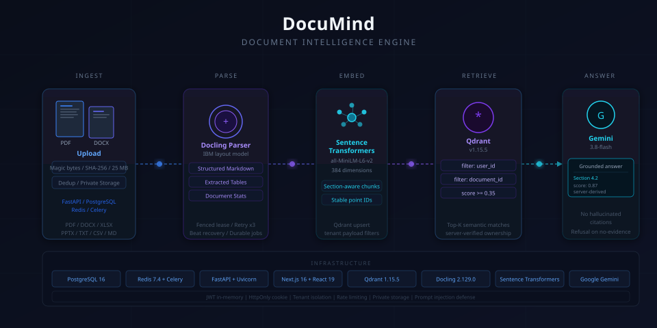
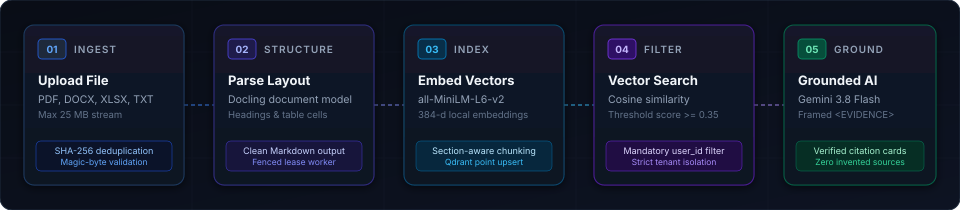
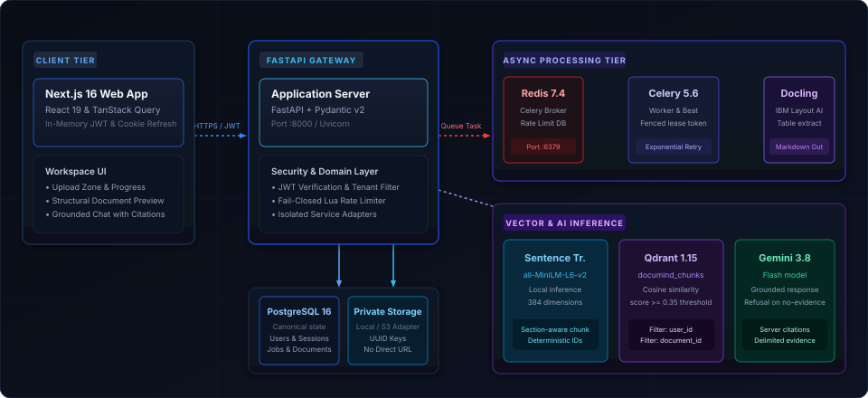
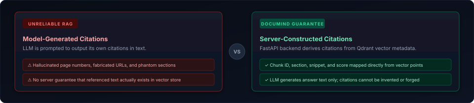

<div align="center">



<br/>

**Private Documents. Structural Understanding. Verifiable Answers.**

*An open-source workspace that turns complex documents into structured, searchable knowledge — with layout-aware parsing, local semantic vector search, and grounded answers backed by server-verified citations.*

<br/>

[](backend/pyproject.toml)
[](backend/pyproject.toml)
[](frontend/package.json)
[](frontend/tsconfig.json)
[](docker-compose.yml)
[](docker-compose.yml)
[](backend/pyproject.toml)
[](LICENSE)

<br/>

[Quick Start](#quick-start) &middot; [Product Views](#product-workspace) &middot; [Workflow](#processing-workflow) &middot; [Architecture](#system-architecture) &middot; [Trust & Security](#trust--security-guarantees) &middot; [Tech Stack](#essential-technology-stack) &middot; [Documentation](#documentation-index)

</div>

---

## What is DocuMind?

Most document Q&A tools treat documents as unstructured blobs of text: they strip tables, ignore layout hierarchy, pass untrusted text straight to an LLM, and let the model hallucinate citations.

**DocuMind** is an open-source, privately-hosted document intelligence platform engineered for technical and structured documents. It preserves tables and headings during parsing, indexes content locally with open-source embeddings, and synthesizes answers using Google Gemini while constructing citations on the server from verified vector search metadata.

### Core Capabilities

- **Structure-Preserving Parsing** — IBM Docling extracts layout hierarchy, multi-column reading order, and tabular data into clean Markdown.
- **Local Semantic Retrieval** — Embeds document sections locally using `all-MiniLM-L6-v2` (384-d) via Sentence Transformers, without leaking embedding requests to external APIs.
- **Grounded Conversational Q&A** — Generates answers with Gemini 3.8 Flash bounded by strict `<DOCUMENT_EVIDENCE>` delimiters.
- **Server-Constructed Citations** — Chunk IDs, section titles, and relevance scores are assembled by the backend from Qdrant metadata; the LLM cannot invent citations.
- **Strict Tenant & Document Isolation** — All vector search queries enforce mandatory `user_id` and `document_id` payload filters.
- **Durable Job Orchestration** — Background parsing jobs are tracked in PostgreSQL with atomic `lease_token` claims, exponential backoff retries, and Celery Beat lease recovery.

---

## Product Workspace

The DocuMind workspace is a dark-mode Next.js application designed for inspecting complex documents and verifying AI-generated answers.

<div align="center">

| Workspace View | Description | Key Capabilities |
|---|---|---|
| **Document Library** | Multi-file document manager with real-time status badges | Magic-byte upload validation, SHA-256 deduplication, progress streaming |
| **Structural Preview** | Split-pane reader showing parsed Markdown and extracted tables | Table structure extraction, document metrics, multi-format export (MD, HTML, JSON) |
| **Grounded Chat** | Conversational panel with verified citation cards | Evidence score thresholding (`>= 0.35`), deterministic refusal on no evidence, citation inspector |

</div>

> [!NOTE]
> **Screenshot Status:** Genuine product screenshots require a running local stack. When launching locally via `docker compose up`, capture views at `http://localhost:3000` to populate `docs/assets/` (`workspace-library.png`, `workspace-preview.png`, `workspace-chat.png`).

---

## Processing Workflow

Every uploaded document moves through a recoverable, state-machine pipeline backed by PostgreSQL and Celery.

<div align="center">



</div>

1. **Upload & Validation** — Accepts PDF, DOCX, XLSX, PPTX, TXT, CSV, and MD up to 25 MB. Verifies file magic bytes, computes SHA-256 checksum for deduplication, and streams bytes to private storage.
2. **Structure Parsing** — Celery worker claims the job using an atomic UUIDv4 `lease_token`. IBM Docling parses layout, section headers, and table cells into structured Markdown.
3. **Chunking & Embedding** — Splits Markdown along section boundaries into deterministic chunks. Generates 384-dimensional dense vectors locally via Sentence Transformers (`all-MiniLM-L6-v2`).
4. **Filtered Vector Search** — Upserts points to Qdrant collection `documind_chunks`. Query execution enforces strict tenant payload filters and rejects evidence below a relevance score of `0.35`.
5. **Grounded Answer Synthesis** — Formulates answers via Google Gemini 3.8 Flash inside explicit evidence fences. Citations are derived server-side from verified vector results.

---

## System Architecture

DocuMind follows a modular monolith pattern with explicit service isolation. Third-party SDKs (Docling, Qdrant, Sentence Transformers, Gemini) are quarantined in dedicated service adapters and never exposed to route handlers.

<div align="center">



</div>

### Architectural Tiers

- **Client Tier** — Next.js 16 App Router, React 19, and TanStack Query. Access JWTs are stored in React memory only; session refresh is handled by HttpOnly cookies.
- **FastAPI Gateway** — Validates incoming requests, enforces ownership dependencies, applies sliding-window Lua rate limits, and routes to domain services.
- **Durable Persistence** — PostgreSQL 16 is the single source of truth for users, documents, processing jobs, and sessions. Qdrant is treated as a rebuildable derived vector index.
- **Private Storage Port** — Decouples file persistence via a clean abstraction supporting local filesystem volumes and S3-compatible object stores (MinIO/AWS S3). Raw file paths and storage keys are never exposed to clients.
- **Async Processing & AI** — Redis 7.4 broker with Celery workers for CPU/memory-intensive parsing. Local vector embeddings run in-process, vector search runs in Qdrant, and grounded generation queries Gemini.

*For detailed architectural decisions and sequence flows, see [docs/ARCHITECTURE.md](docs/ARCHITECTURE.md) and [docs/ARCHITECTURE-DECISIONS.md](docs/ARCHITECTURE-DECISIONS.md).*

---

## Trust & Security Guarantees

DocuMind is designed with defensive defaults to protect document privacy and prevent LLM hallucinations.

<div align="center">



</div>

### 1. Server-Derived Citation Integrity
LLMs frequently hallucinate page numbers, section titles, and source quotations when asked to cite sources directly. DocuMind completely strips citation generation from the model's responsibility:
- The FastAPI backend retrieves chunks from Qdrant and filters them by score (`>= 0.35`).
- The backend constructs citation objects directly from the vector store metadata (`chunk_id`, `section`, `score`).
- The LLM only writes the explanatory text. If no retrieved chunks exceed the relevance threshold, the system returns a deterministic refusal message without invoking the LLM.

### 2. Strict Tenant Isolation & Anti-Enumeration
- Every Qdrant vector search includes mandatory `user_id` and `document_id` payload filters enforced at the server level.
- Attempting to access another user's document returns a `404 Not Found` (never a `403 Forbidden`), preventing attackers from enumerating valid document IDs across tenants.

### 3. Safe Storage & Dual-Token Authentication
- **Zero Raw File Leakage:** Storage keys and S3 URIs remain strictly internal. Download and raw file access are always verified against user ownership and streamed through authenticated endpoints.
- **Memory-Only Access Tokens:** Access tokens reside exclusively in React state (never `localStorage` or `sessionStorage`), protecting against XSS token theft. Session renewal uses a rotating HttpOnly, SameSite refresh cookie with SHA-256 token-family reuse detection.
- **Fail-Closed Rate Limiting:** Sliding-window rate limits run via atomic Redis Lua scripts. If Redis is unreachable, the system fails closed (HTTP 503) rather than allowing unmetered LLM calls.

---

## Quick Start

Launch the complete 7-service DocuMind stack locally with Docker Compose.

### Prerequisites

- [Docker Desktop](https://www.docker.com/) (version 24+) and Docker Compose v2.
- A [Google Gemini API Key](https://aistudio.google.com/app/apikey) (optional, required only for grounded chat Q&A).

### 1. Clone and Configure

```bash
git clone https://github.com/yashrajagawane/documind.git
cd documind
cp .env.example .env
```

Open `.env` and set your secrets:

```env
# Required: Choose a secure password for PostgreSQL
POSTGRES_PASSWORD=your_secure_password_here

# Required: Generate with: openssl rand -hex 32
JWT_SECRET_KEY=your_generated_jwt_secret_key_here

# Optional: Needed for grounded chat Q&A (retrieval and parsing work without it)
GEMINI_API_KEY=your_gemini_api_key_here
```

### 2. Launch the Stack

```bash
docker compose up --build -d
```

Docker Compose boots seven coordinated services:
- `postgres` — Relational database on port `5432`
- `redis` — Celery broker and rate limit store on port `6379`
- `qdrant` — Vector database on port `6333`
- `backend` — FastAPI application on port `8000`
- `worker` — Celery document processing worker
- `scheduler` — Celery Beat lease recovery daemon
- `frontend` — Next.js workspace UI on port `3000`

### 3. Verify and Access

Once the containers report healthy:

| Service | URL | Notes |
|---|---|---|
| **Workspace Web App** | [http://localhost:3000](http://localhost:3000) | Register an account and upload documents |
| **Interactive API Docs** | [http://localhost:8000/docs](http://localhost:8000/docs) | Swagger OpenAPI documentation |
| **Health Liveness Probe** | [http://localhost:8000/api/v1/health](http://localhost:8000/api/v1/health) | Returns `{"status": "healthy"}` |
| **Qdrant Web Console** | [http://localhost:6333/dashboard](http://localhost:6333/dashboard) | Inspect vector collections and points |

To verify deployment integrity, run the authenticated smoke test:

```bash
python scripts/smoke_test.py
```

---

## Essential Technology Stack

```
Frontend               Next.js 16 (App Router) · React 19 · TypeScript 5.9 · TanStack Query 5
Backend                FastAPI 0.141 · Python 3.11/3.12 · Pydantic v2 · SQLAlchemy 2.0 (asyncpg)
Data & Storage         PostgreSQL 16 · Redis 7.4 · Celery 5.6 + Beat · Private Storage (Local / S3)
Document AI & Search   IBM Docling 2.129 · Sentence Transformers (all-MiniLM-L6-v2) · Qdrant 1.15 · Gemini 3.8 Flash
Testing & Tooling      Pytest · Vitest · Testing Library · Docker Compose · Ruff
```

---

## Documentation Index

Detailed implementation guides, design records, and API contracts are available in the `docs/` directory:

| Document | Description |
|---|---|
| [API Reference](docs/API.md) | Complete endpoint catalog, request/response JSON payloads, and error envelopes |
| [Configuration Reference](docs/CONFIGURATION.md) | Full list of environment variables, defaults, and production requirements |
| [Architecture Guide](docs/ARCHITECTURE.md) | Component boundaries, ingestion flows, and service layer architecture |
| [Architecture Decisions (ADRs)](docs/ARCHITECTURE-DECISIONS.md) | Accepted ADRs (ADR-001 through ADR-008) governing technology and design choices |
| [Design System](docs/DESIGN.md) | Dark-mode design tokens, typography, component states, and accessibility standards |
| [Project Roadmap](docs/ROADMAP.md) | Completed milestones and upcoming features (cross-document search, hybrid retrieval) |

---

## Project Status & Limitations

DocuMind is an active, production-grade open-source project. In the spirit of engineering transparency, please note these current limitations:

- **S3 Storage Live Qualification** — The S3 storage adapter is fully implemented with Boto3 and AES-256 SSE, but requires qualification in your target production environment.
- **Worker Memory Footprint** — IBM Docling layout models require at least 4 GB of RAM allocated to the Celery worker container during intensive parsing tasks.
- **Monitoring Dashboards** — Prometheus metrics are exported at `/api/v1/metrics`, but production Grafana dashboards and alerting rules are deployment-specific.
- **Security Audit** — While designed with defensive security controls (JWT in memory, CSRF/XSS mitigations, fail-closed rate limits), DocuMind has not undergone an independent third-party commercial penetration audit.

---

## Contributing & Developer Workflow

Contributions are welcome! Please follow these steps for local development:

```bash
# Backend linting and unit testing
cd backend
pip install -e ".[dev]"
ruff check .
pytest

# Frontend typechecking and unit testing
cd ../frontend
npm install
npm run typecheck
npm test
```

Please ensure all tests pass and code compiles before submitting a pull request. Refer to the [Architecture Decision Records](docs/ARCHITECTURE-DECISIONS.md) before proposing significant architectural changes.

---

## License

DocuMind is open-source software licensed under the [MIT License](LICENSE).
