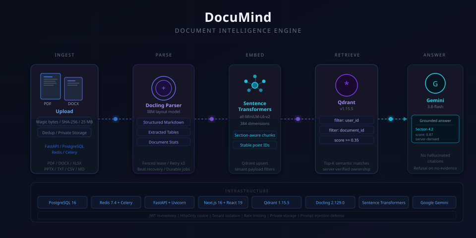
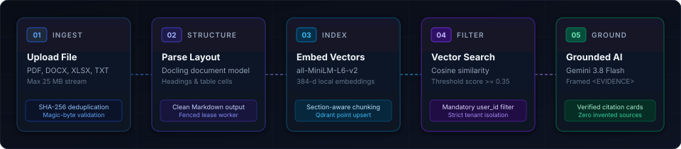
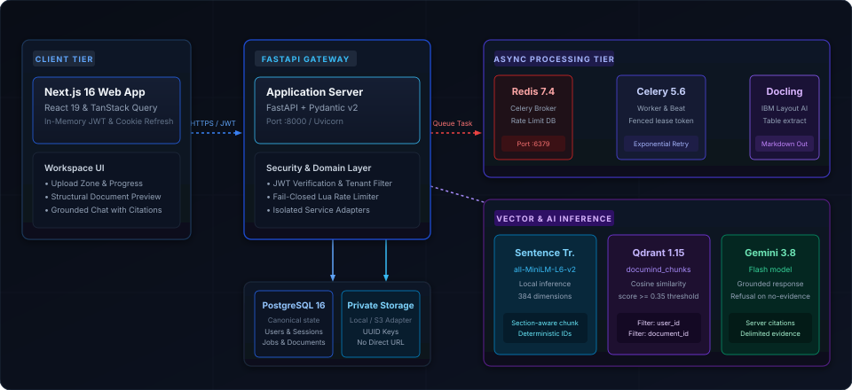
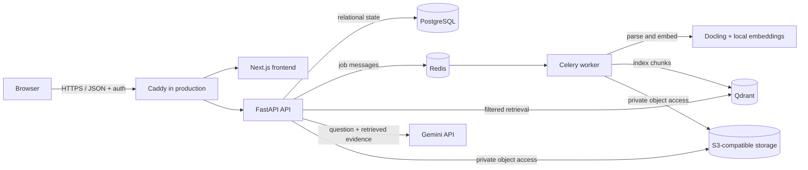
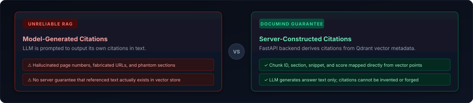
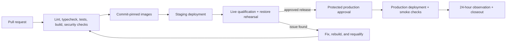

<div align="center">



<br/>

**Private Documents. Structural Understanding. Verifiable Answers.**

*An open-source workspace that turns complex documents into structured, searchable knowledge — with layout-aware parsing, local semantic vector search, and grounded answers backed by server-verified citations.*

<br/>

[](backend/pyproject.toml)
[](backend/pyproject.toml)
[](frontend/package.json)
[](frontend/tsconfig.json)
[](docker-compose.yml)
[](docker-compose.yml)
[](backend/pyproject.toml)
[](https://github.com/yashrajagawane/documind/actions/workflows/ci.yml)
[](LICENSE)

<br/>

[Get Started](#quick-start) &middot; [Capabilities](#what-is-documind) &middot; [Architecture](#system-architecture) &middot; [Security](#trust--security-guarantees) &middot; [Deploy](#production-deployment) &middot; [Operations](#observability--recovery) &middot; [Docs](#documentation-index)

</div>

---

> **Project status:** The application, deployment automation, and operational tooling are implemented. A live production launch is **not yet qualified**: staging verification, provider-specific checks, and a restore rehearsal still need to be completed. See [Project Status & Limitations](#project-status--limitations) before deploying with real documents.

### Choose your path

| If you want to… | Start here |
|---|---|
| Try the complete application locally | [Quick Start](#quick-start) |
| Change the frontend or backend | [Local Development](#local-development) and [Contributing](#contributing--developer-workflow) |
| Integrate with the service | [API at a Glance](#api-at-a-glance) and [API Reference](docs/API.md) |
| Operate a hosted instance | [Production Deployment](#production-deployment) and [Operations & Troubleshooting](#operations--troubleshooting) |
| Assess current release readiness | [Project Status & Limitations](#project-status--limitations) |

<details>
<summary><strong>Contents</strong></summary>

- [What is DocuMind?](#what-is-documind)
- [Product Workspace](#product-workspace)
- [Processing Workflow](#processing-workflow)
- [System Architecture](#system-architecture)
- [Trust & Security Guarantees](#trust--security-guarantees)
- [Quick Start](#quick-start)
  - [Prerequisites](#prerequisites)
  - [Your first document](#your-first-document)
- [Local Development](#local-development)
- [API at a Glance](#api-at-a-glance)
  - [Minimal authenticated API flow](#minimal-authenticated-api-flow)
- [Configuration & Secrets](#configuration--secrets)
- [Operations & Troubleshooting](#operations--troubleshooting)
  - [First-response checklist](#first-response-checklist)
- [Production Deployment](#production-deployment)
- [Observability & Recovery](#observability--recovery)
- [Essential Technology Stack](#essential-technology-stack)
- [Repository Guide](#repository-guide)
- [Documentation Index](#documentation-index)
- [Project Status & Limitations](#project-status--limitations)
- [Contributing & Developer Workflow](#contributing--developer-workflow)
- [License](#license)

</details>

---

## What is DocuMind?

Most document Q&A tools treat documents as unstructured blobs of text: they strip tables, ignore layout hierarchy, pass untrusted text straight to an LLM, and let the model hallucinate citations.

**DocuMind** is an open-source document intelligence platform designed for self-hosting and technical or structured documents. It preserves tables and headings during parsing, indexes content locally with open-source embeddings, and can synthesize answers using Google Gemini while constructing citations on the server from verified vector search metadata.

### Core Capabilities

- **Structure-Preserving Parsing** — IBM Docling extracts layout hierarchy, multi-column reading order, and tabular data into clean Markdown.
- **Local Semantic Retrieval** — Embeds document sections locally using `all-MiniLM-L6-v2` (384-d) via Sentence Transformers, without leaking embedding requests to external APIs.
- **Grounded Conversational Q&A** — Generates answers with Gemini 3.8 Flash bounded by strict `<DOCUMENT_EVIDENCE>` delimiters.
- **Server-Constructed Citations** — Chunk IDs, section titles, and relevance scores are assembled by the backend from Qdrant metadata; the LLM cannot invent citations.
- **Strict Tenant & Document Isolation** — All vector search queries enforce mandatory `user_id` and `document_id` payload filters.

### At a Glance

| Area | Current behavior |
|---|---|
| Supported uploads | PDF, DOCX, XLSX, PPTX, TXT, CSV, and Markdown; default maximum size is 25 MB |
| Processing | Durable Celery jobs, lease-based recovery, and visible per-document processing state |
| Search | Local 384-dimensional embeddings with Qdrant filtering by owner and document |
| Answers | Gemini-backed document Q&A when `GEMINI_API_KEY` is configured; deterministic no-evidence response otherwise |
| Exports | Parsed content as Markdown, text, JSON, HTML, or original upload |
| Deployment shape | Docker Compose on a single host, with a separate hardened production overlay |
| Source of truth | PostgreSQL owns accounts, document metadata, and processing lifecycle; vectors are rebuildable |

DocuMind is designed for private, single-host deployments and portfolio-scale use. Before treating it as a production service, complete the live qualification steps described in the deployment runbook and status section below.

### Who it is for

- **Researchers and analysts** who need to inspect lengthy reports and trace answers back to source sections.
- **Builders and teams** evaluating a self-hosted document parsing and retrieval stack.
- **Developers** who want a reference implementation for asynchronous ingestion, scoped retrieval, and citation integrity.

### Design promises

| Promise | How the system supports it |
|---|---|
| Answers should be inspectable | Responses include citation metadata resolved from retrieved chunks |
| Data access should be scoped | Ownership checks apply at the API and vector-query boundary |
| Parsing should be recoverable | PostgreSQL job state, Celery delivery, leases, and scheduled reconciliation cooperate to recover stale work |
| Derived search data should be replaceable | PostgreSQL and stored parsed artifacts can be used to rebuild the Qdrant index |

These are implementation goals and controls, not a guarantee of perfect extraction, answer accuracy, or uninterrupted availability. Verify important source material directly in the document preview.

---

## Product Workspace

The DocuMind workspace is a dark-mode Next.js application featuring an interactive resizable split-pane layout designed for inspecting complex documents and verifying AI-generated answers.

<div align="center">

| Workspace View | Description | Key Capabilities |
|---|---|---|
| **Document Library** | Multi-file document manager with real-time status badges | Instant search (`/` shortcut), status filter pills (`All`, `Ready`, `Processing`, `Failed`), skeleton loading placeholders, SHA-256 deduplication |
| **Structural Preview** | Document reader showing parsed Markdown and extracted tables | Syntax-highlighted code blocks with 1-click copy, table structure extraction, document metrics, multi-format export (MD, HTML, JSON) |
| **Grounded Chat & Shell** | Draggable split-pane panel with verified citation cards | Smooth mouse/keyboard resizable panes (`ArrowLeft`/`ArrowRight`), `localStorage` layout persistence, evidence score thresholding (`>= 0.35`), citation inspector |

</div>

> **Screenshots:** Product UI screenshots are not currently included. The SVGs in `docs/assets/` illustrate the workflow, architecture, and citation model. When adding UI screenshots, use synthetic documents and remove personal or account data before committing them.

---

## Processing Workflow

Every uploaded document moves through a recoverable, state-machine pipeline backed by PostgreSQL and Celery.

<div align="center">



</div>

1. **Upload & Validation** — Accepts PDF, DOCX, XLSX, PPTX, TXT, CSV, and MD up to 25 MB. Verifies file magic bytes, computes SHA-256 checksum for deduplication, and streams bytes to private storage.
2. **Structure Parsing** — Celery worker claims the job using an atomic UUIDv4 `lease_token`. IBM Docling parses layout, section headers, and table cells into structured Markdown.
3. **Chunking & Embedding** — Splits Markdown along section boundaries into deterministic chunks. Generates 384-dimensional dense vectors locally via Sentence Transformers (`all-MiniLM-L6-v2`).
4. **Filtered Vector Search** — Upserts points to Qdrant collection `documind_chunks`. Query execution enforces strict tenant payload filters and rejects evidence below a relevance score of `0.35`.
5. **Grounded Answer Synthesis** — Formulates answers via Google Gemini 3.8 Flash inside explicit evidence fences. Citations are derived server-side from verified vector results.

### Supported file formats

| Format | Typical content | Practical note |
|---|---|---|
| PDF | Text, page layout, tables, and scanned pages | Scanned PDFs depend on OCR quality and may need more worker memory |
| DOCX | Headings, paragraphs, and tables | Complex page styling is represented as extracted content, not reproduced as a Word layout |
| XLSX | Workbook and sheet content | Validate important formulas and multi-sheet relationships in the preview |
| PPTX | Slide text and structure | Visual relationships and image-only text may not be fully represented in extracted text |
| TXT, CSV, Markdown | Plain text, rows, and Markdown structure | Best suited to text-first files with consistent encoding and delimiters |

The default upload cap is 25 MB. Parsing quality depends on the source file; check the structural preview and tables before relying on an answer or export. For file validation details and configurable limits, see [Configuration Reference](docs/CONFIGURATION.md).

### Processing lifecycle

| State | Meaning | Next action |
|---|---|---|
| `uploaded` / `queued` | File is stored and waiting for a worker | The worker claims the queued job |
| `processing` / `extracting` / `chunking` / `indexing` | Parsing and indexing stages are in progress | Poll document status; the UI surfaces current progress |
| `ready` | Parsed artifact is available and the document can be previewed or queried | Inspect the preview; use chat and exports |
| `failed` | Processing exhausted or encountered a non-recoverable error | Review the error, correct the source/configuration if needed, then retry |

The worker uses a bounded attempt policy. A retry requeues a failed document through the API; repeated rapid retries do not repair invalid input or a missing dependency. See the [processing architecture](docs/ARCHITECTURE.md) for leases, recovery, and job ownership details.

---

## System Architecture

DocuMind follows a modular monolith pattern with explicit service isolation. Third-party SDKs (Docling, Qdrant, Sentence Transformers, Gemini) are quarantined in dedicated service adapters and never exposed to route handlers.

<div align="center">



</div>

### Architectural Tiers

- **Client Tier** — Next.js 16 App Router, React 19, and TanStack Query. Access JWTs are stored in React memory only; session refresh is handled by HttpOnly cookies.
- **FastAPI Gateway** — Validates incoming requests, enforces ownership dependencies, applies sliding-window Lua rate limits, and routes to domain services.
- **Durable Persistence** — PostgreSQL 16 is the single source of truth for users, documents, processing jobs, and sessions. Qdrant is treated as a rebuildable derived vector index.
- **Private Storage Port** — Decouples file persistence via a clean abstraction supporting local filesystem volumes and S3-compatible object stores (MinIO/AWS S3). Raw file paths and storage keys are never exposed to clients.
- **Async Processing & AI** — Redis 7.4 broker with Celery workers for CPU/memory-intensive parsing. Local vector embeddings run in-process, vector search runs in Qdrant, and grounded generation queries Gemini.

*For detailed architectural decisions and sequence flows, see [docs/ARCHITECTURE.md](docs/ARCHITECTURE.md) and [docs/ARCHITECTURE-DECISIONS.md](docs/ARCHITECTURE-DECISIONS.md).*

### Request and data boundaries



The browser talks to the web/API edge only. Data stores and the worker are internal services in the production Compose network. Gemini is an outbound provider call made by the backend after retrieval; only the question and selected evidence are sent for answer generation.

---

## Trust & Security Guarantees

DocuMind is designed with defensive defaults to protect document privacy and prevent LLM hallucinations.

<div align="center">



</div>

### 1. Server-Derived Citation Integrity
LLMs frequently hallucinate page numbers, section titles, and source quotations when asked to cite sources directly. DocuMind completely strips citation generation from the model's responsibility:
- The FastAPI backend retrieves chunks from Qdrant and filters them by score (`>= 0.35`).
- The backend constructs citation objects directly from the vector store metadata (`chunk_id`, `section`, `score`).
- The LLM only writes the explanatory text. If no retrieved chunks exceed the relevance threshold, the system returns a deterministic refusal message without invoking the LLM.

### 2. Strict Tenant Isolation & Anti-Enumeration
- Every Qdrant vector search includes mandatory `user_id` and `document_id` payload filters enforced at the server level.
- Attempting to access another user's document returns a `404 Not Found` (never a `403 Forbidden`), preventing attackers from enumerating valid document IDs across tenants.

### 3. Safe Storage & Dual-Token Authentication
- **Zero Raw File Leakage:** Storage keys and S3 URIs remain strictly internal. Download and raw file access are always verified against user ownership and streamed through authenticated endpoints.
- **Memory-Only Access Tokens:** Access tokens reside exclusively in React state (never `localStorage` or `sessionStorage`), protecting against XSS token theft. Session renewal uses a rotating HttpOnly, SameSite refresh cookie with SHA-256 token-family reuse detection.
- **Fail-Closed Rate Limiting:** Sliding-window rate limits run via atomic Redis Lua scripts. If Redis is unreachable, the system fails closed (HTTP 503) rather than allowing unmetered LLM calls.

### Security control map

| Boundary | Control in the application | Operator responsibility |
|---|---|---|
| Account credentials | Password hashing, short-lived access JWT, rotating HttpOnly refresh cookie | Protect signing secrets and configure secure HTTPS cookies |
| Document ownership | Server-side ownership checks and per-user vector filters | Keep service credentials private and qualify cross-user access behavior in staging |
| Uploaded files | Private storage abstraction and authenticated download route | Configure private bucket policy, encryption, retention, and credential scope |
| Public network | Production overlay exposes Caddy as the public edge | Restrict host firewall and verify actual provider firewall and published ports |
| AI provider | Backend sends bounded retrieved context to Gemini | Review provider terms; do not assume local embeddings mean all AI processing stays local |
| Operations access | Metrics token and loopback-bound observability ports | Rotate credentials, restrict dashboard access, and rehearse incident response |

This is a practical boundary map, not a certification or penetration-test report. The system has not had an independent third-party security audit.

---

## Quick Start

Launch the complete 7-service DocuMind stack locally with Docker Compose.

> **Local-only stack:** `docker-compose.yml` publishes service ports for development convenience. Run it only on a trusted machine/network; do not expose it directly to the internet or process real private documents. The production overlay removes public data-service ports and routes traffic through Caddy.

### Prerequisites

- [Docker Desktop](https://www.docker.com/) (version 24+) and Docker Compose v2.
- A [Google Gemini API Key](https://aistudio.google.com/app/apikey) (optional, required only for grounded chat Q&A).

### 1. Clone and Configure

```bash
git clone https://github.com/yashrajagawane/documind.git
cd documind
cp .env.example .env
```

Open `.env` and set your secrets:

```env
# Required: Choose a secure password for PostgreSQL
POSTGRES_PASSWORD=your_secure_password_here

# Required: Generate with: openssl rand -hex 32
JWT_SECRET_KEY=your_generated_jwt_secret_key_here

# Optional: Needed for grounded chat Q&A (retrieval and parsing work without it)
GEMINI_API_KEY=your_gemini_api_key_here
```

### 2. Launch the Stack

```bash
docker compose up --build -d
```

Apply the database schema before creating an account. The production overlay has a one-shot migration service; the local development Compose file leaves migrations explicit:

```bash
docker compose exec backend alembic upgrade head
```

Check startup before opening the UI:

```bash
docker compose ps
curl --fail http://localhost:8000/api/v1/ready
```

The first build and model initialization can take several minutes. If readiness does not pass, inspect `docker compose logs --tail=100 backend worker` and resolve the reported dependency or resource issue before uploading a sample.

Docker Compose boots seven coordinated services:
- `postgres` — Relational database on port `5432`
- `redis` — Celery broker and rate limit store on port `6379`
- `qdrant` — Vector database on port `6333`
- `backend` — FastAPI application on port `8000`
- `worker` — Celery document processing worker
- `scheduler` — Celery Beat lease recovery daemon
- `frontend` — Next.js workspace UI on port `3000`

### 3. Verify and Access

Once the containers report healthy:

| Service | URL | Notes |
|---|---|---|
| **Workspace Web App** | [http://localhost:3000](http://localhost:3000) | Register an account and upload documents |
| **Interactive API Docs** | [http://localhost:8000/docs](http://localhost:8000/docs) | Swagger OpenAPI documentation |
| **Health Liveness Probe** | [http://localhost:8000/api/v1/health](http://localhost:8000/api/v1/health) | Returns `{"status": "healthy"}` |
| **Qdrant Web Console** | [http://localhost:6333/dashboard](http://localhost:6333/dashboard) | Inspect vector collections and points |

To verify deployment integrity, run the authenticated smoke test:

```bash
python scripts/smoke_test.py
```

### Your first document

1. Open the workspace and create a local account.
2. Upload a small, non-sensitive sample in one of the supported formats.
3. Wait for the status to become `ready`; inspect the parsed preview and any extracted tables.
4. Ask a question whose answer appears in the document. Review the returned citation against the source.
5. Export the parsed content or remove the sample document when finished.

The first run may take longer while containers and the embedding model are initialized. Chat requires `GEMINI_API_KEY`; the rest of the local document flow can be explored without it.

### Stop, Inspect, and Reset

```bash
# Follow all service logs
docker compose logs -f --tail=100

# Stop containers while keeping database, vector, and upload volumes
docker compose down

# Stop containers and permanently delete local Compose volumes
docker compose down --volumes
```

The final command deletes local database, Qdrant, and uploaded-file data. Use it only when you intend to reset the development instance.

---

## Operations & Troubleshooting

### Inspect the stack

```bash
docker compose ps
docker compose logs --tail=100 backend worker scheduler
docker compose exec backend alembic current
```

The API's `/api/v1/health` endpoint checks that the process responds. `/api/v1/ready` also checks PostgreSQL and Redis and should be used as the readiness signal. A document may need time to pass through parsing, chunking, and indexing; poll its document status before retrying.

| Signal | What it tells you | Expected use |
|---|---|---|
| `/api/v1/health` | API process can answer a request | Liveness probe and quick endpoint check |
| `/api/v1/ready` | API plus PostgreSQL and Redis are reachable | Readiness check before sending application traffic |
| `/api/v1/metrics` | Operational counters and histograms are available | Prometheus scrape using `X-Metrics-Token` |
| Compose service health | Role-specific container checks for API, frontend, worker, scheduler, and dependencies | Host-level triage alongside service logs |

### Common symptoms

| Symptom | First checks |
|---|---|
| Frontend cannot reach API | Confirm `NEXT_PUBLIC_API_BASE_URL`, browser-reachable backend URL, and `CORS_ORIGINS` agree |
| Upload remains processing | Inspect worker and scheduler logs, then check PostgreSQL and Redis health; review lease and attempt settings |
| Parsing fails or container exits | Check available memory; Docling can need 4 GB or more during intensive parsing |
| Chat reports unavailable | Confirm `GEMINI_API_KEY`, Gemini connectivity, Qdrant health, and that the document has indexed chunks |
| Chat returns no evidence | Rephrase around document wording, verify indexing completed, and review `RETRIEVAL_MIN_SCORE` |
| Production validation fails | Run `scripts/validate_production_config.py` against the selected environment file and fix every reported issue |

### First-response checklist

1. Note the time, affected flow, environment, and any API `request_id` returned in an error.
2. Capture service status and the relevant backend, worker, scheduler, and proxy logs.
3. Check readiness and dependent services before retrying an upload, deletion, migration, or deployment.
4. Preserve logs and backup identifiers; do not remove Docker volumes or re-run migrations as a diagnostic shortcut.
5. Follow the release rollback or recovery runbook if data integrity, authentication, or cross-user isolation may be affected.

Avoid disabling ownership checks, CORS validation, rate limiting, or network isolation to work around an error. For deeper procedures, see the [production runbook](docs/DEPLOYMENT-PRODUCTION.md) and [configuration reference](docs/CONFIGURATION.md).

---

## Production Deployment

The supported production baseline is a single Linux host running Docker Compose, with Caddy terminating HTTPS. The production overlay removes public ports from PostgreSQL, Redis, Qdrant, the API, worker, scheduler, and frontend; only Caddy publishes ports 80 and 443.

Before pointing real users or private documents at a host, prepare DNS and firewall rules, private encrypted object storage, independent staging resources, monitoring credentials, and a verified backup plan. Production requires private S3-compatible storage, secure refresh cookies, an HTTPS-only CORS origin, non-template secrets, and an authenticated Qdrant service.

### Host planning notes

| Resource | Planning guidance |
|---|---|
| Worker memory | Allocate at least 4 GB to the Celery worker for intensive Docling parsing workloads |
| Persistent disk | Budget separately for PostgreSQL, Redis, Qdrant, model cache, Caddy state, and temporary backup space |
| Object storage | Use a private S3-compatible bucket with scoped credentials, server-side encryption, and a tested recovery path |
| Network ingress | Publish only SSH administration as restricted by policy and HTTPS ingress on ports 80/443; keep data services private |
| External egress | Allow access to Gemini when chat is enabled and to the model source when model artifacts need to be fetched |

These are service-planning notes rather than a universal instance size. Measure CPU, memory, disk growth, and restore time with representative synthetic documents in staging before sizing production.

The repository includes a production environment template and a validation command:

```bash
cp .env.production.example .env.production
chmod 600 .env.production
python scripts/validate_production_config.py --env-file .env.production
```

Check out the release candidate commit first. Set `GIT_SHA` to that full commit SHA and use the matching GHCR images, then run the stronger preflight. It validates production settings, immutable image tags, and the effective Compose port exposure before deployment:

```bash
GIT_SHA=$(git rev-parse HEAD)
export DOCUMIND_BACKEND_IMAGE=ghcr.io/yashrajagawane/documind-backend:$GIT_SHA
export DOCUMIND_FRONTEND_IMAGE=ghcr.io/yashrajagawane/documind-frontend:$GIT_SHA

python scripts/production_preflight.py \
  --env-file .env.production \
  --backend-image "$DOCUMIND_BACKEND_IMAGE" \
  --frontend-image "$DOCUMIND_FRONTEND_IMAGE"
```

`GIT_SHA` must contain the full 40-character commit SHA. The preflight requires Docker Compose and valid production values; it does not deploy the release or substitute for staging qualification.

Do not use the local `.env.example` as a production configuration. Use the full step-by-step instructions in [Production Deployment Runbook](docs/DEPLOYMENT-PRODUCTION.md), including host setup, firewall rules, qualification, rollback, and secret provisioning.

### Automated release path

1. A push or pull request runs frontend lint, typecheck, tests, and build; backend lint, tests, and migration SQL generation.
2. Successful pushes build and publish backend and frontend images to GHCR, tagged by commit SHA; release tags provide readable aliases.
3. Operators dispatch the staging deployment workflow with an approved image tag and qualify that environment.
4. Production deployment uses the same versioned images, a protected GitHub environment approval, a pre-deploy backup reference, migrations, and authenticated post-deploy smoke checks.
5. The workflow saves a sanitized release record. Rollback uses a known-good image while database changes remain forward-only.

Configure GitHub environments, host SSH credentials, image registry access, protected production reviewers, and smoke-test credentials as documented in the runbook. Workflow files are in [`.github/workflows`](.github/workflows).



The release gate is evidence-based: passing CI builds the candidate, while staging qualification and protected approval determine whether it can proceed to production.

---

## Observability & Recovery

The production Compose overlay provides an optional `observability` profile with Prometheus, Alertmanager, and Grafana. The metrics endpoint is protected by `METRICS_TOKEN`; the dashboards and alert rules are provisioned from `infra/monitoring/`. Keep the observability UIs bound to localhost or behind an authenticated private access layer.

PostgreSQL is the authoritative application store. The repository includes encrypted backup and disposable restore scripts; Qdrant is a derived index with a rebuild utility. A backup is not qualified until a restore has been exercised and the restored application data has been checked.

Operational assets include:

- `scripts/backup_postgres.sh` — create an encrypted PostgreSQL backup.
- `scripts/restore_postgres_disposable.sh` — restore into a disposable target for rehearsal.
- `backend/app/indexing/rebuild.py` — rebuild vector data from ready PostgreSQL documents and parsed artifacts; run with `cd backend && python -m app.indexing.rebuild` in an environment with indexing dependencies and service configuration.
- `infra/systemd/` — example systemd service/timer assets for scheduled backup execution.
- `infra/monitoring/` — Prometheus scraping, alert rules, Alertmanager configuration, and Grafana provisioning.

### Recovery targets and evidence

| Objective | Initial target | Evidence needed to accept it |
|---|---:|---|
| Recovery point objective (RPO) | 24 hours | Confirm backup schedule, successful encrypted object upload, and restore point coverage |
| Recovery time objective (RTO) | 8 hours | Time a disposable restore and service recovery rehearsal end to end |

These are recorded planning targets, not measured service guarantees. Record actual restore duration, data verification, and any gaps during staging qualification; revise the targets if the chosen host or storage service cannot meet them.

Record backup retention, encryption key custody, restore duration, and the result of a rehearsal in the deployment record. Follow the [production runbook](docs/DEPLOYMENT-PRODUCTION.md) for exact host commands and the [production launch report](docs/PRODUCTION-LAUNCH-REPORT.md) for sign-off evidence.

---

## Repository Guide

| Path | Purpose |
|---|---|
| `frontend/` | Next.js web application and client-side API integration |
| `backend/app/api/` | FastAPI routes and HTTP request/response boundaries |
| `backend/app/services/` | Parsing, storage, retrieval, embeddings, and Gemini adapters |
| `backend/app/jobs/` | Celery tasks, lease recovery, and scheduled reconciliation |
| `backend/alembic/` | PostgreSQL schema migrations |
| `backend/tests/` and `frontend/` tests | Backend and frontend automated test suites |
| `tests/evals/` | Retrieval and grounded-answer evaluation tooling |
| `infra/caddy/` | Reverse proxy routing and HTTPS configuration |
| `infra/monitoring/` | Metrics, alerting, and Grafana provisioning |
| `scripts/` | Deployment, validation, smoke testing, backup, restore, and release utilities |
| `docs/` | API contracts, architecture, design, deployment, qualification, and project records |

### Main services

| Service | Responsibility | Persistent or derived data |
|---|---|---|
| `frontend` | Workspace UI | No authoritative application data |
| `backend` | Authenticated API and orchestration | PostgreSQL records; private file objects |
| `worker` / `scheduler` | Document processing and stale-job recovery | PostgreSQL job state and Redis queue messages |
| `postgres` | Source of truth for accounts, documents, sessions, and jobs | Must be backed up |
| `qdrant` | Semantic vector search index | Rebuildable derived index |
| `redis` | Queue broker and distributed rate limit state | Operational state, configured separately from PostgreSQL |
| `proxy` | TLS termination and routing in production | Caddy certificate and configuration volumes |

---

## Essential Technology Stack

```
Frontend               Next.js 16 (App Router) · React 19 · TypeScript 5.9 · TanStack Query 5
Backend                FastAPI 0.141 · Python 3.11/3.12 · Pydantic v2 · SQLAlchemy 2.0 (asyncpg)
Data & Storage         PostgreSQL 16 · Redis 7.4 · Celery 5.6 + Beat · Private Storage (Local / S3)
Document AI & Search   IBM Docling 2.129 · Sentence Transformers (all-MiniLM-L6-v2) · Qdrant 1.15 · Gemini 3.8 Flash
Testing & Tooling      Pytest · Vitest · Testing Library · Docker Compose · Ruff
```

---

## Local Development

Docker Compose is the recommended way to run the whole application. The native development option below runs only PostgreSQL and Qdrant in Compose, then starts the backend and frontend as local processes. Do not start the full Compose stack and native processes at the same time; both modes use ports `3000` and `8000`.

Start the infrastructure dependencies from the repository root:

```bash
cp .env.example .env
docker compose up -d postgres qdrant
```

### Backend

Use Python 3.11 or 3.12. The optional groups install parsing, vector indexing, and Gemini features; the base development group is intended for API and unit-test work.

```bash
cd backend
python -m venv .venv
# Activate the virtual environment for your shell, then:
python -m pip install -e ".[dev,processing,indexing,rag]"
cp ../.env.example .env
```

In `backend/.env`, use the PostgreSQL password set in the root `.env` and set these local-process values:

```env
DATABASE_URL=postgresql+asyncpg://documind:<your-postgres-password>@localhost:5432/documind
JOB_QUEUE_BACKEND=inprocess
QDRANT_URL=http://localhost:6333
RATE_LIMIT_BACKEND=memory
```

Run migrations once, then start the API:

```bash
alembic upgrade head
uvicorn app.main:app --reload --host 0.0.0.0 --port 8000
```

### Frontend

Use Node.js 22 or newer. `NEXT_PUBLIC_API_BASE_URL` must point to the backend API base URL reachable by the browser (normally `http://localhost:8000/api/v1`).

```bash
cd frontend
npm ci
npm run dev
```

The development server opens at `http://localhost:3000`; the API client defaults to `http://localhost:8000/api/v1`. With `JOB_QUEUE_BACKEND=inprocess`, processing jobs run inside the API process, so this mode is for development only. For durable worker processing and the complete service set, use the [Docker Compose quick start](#quick-start).

---

## API at a Glance

The versioned API lives under `/api/v1`; interactive OpenAPI documentation is available at `http://localhost:8000/docs` when the backend is running.

| Capability | Endpoints |
|---|---|
| Authentication | `POST /auth/register`, `/auth/login`, `/auth/refresh`, `/auth/logout` |
| Account | `GET /users/me` |
| Documents | `POST /documents`, `GET /documents`, `GET /documents/{id}`, `DELETE /documents/{id}` |
| Content | `GET /documents/{id}/preview`, `/raw`, `/export`; export formats include `markdown`, `txt`, `json`, `html`, and `original` |
| Processing | `POST /documents/{id}/index`, `/retry`; `GET /processing/{id}/status` |
| Grounded Q&A | `POST /documents/{id}/chat` |
| Operations | `GET /health`, `/ready`, `/metrics` |

Most account and document routes require `Authorization: Bearer <access-token>`. Login returns the short-lived access token and sets the refresh token as an HttpOnly cookie; refresh and logout use that cookie. Metrics require the `X-Metrics-Token` header when a metrics token is configured.

Example health check:

```bash
curl --fail http://localhost:8000/api/v1/health
```

See the [complete API reference](docs/API.md) for request schemas, response examples, authentication details, and error codes. Use `/ready` for dependency readiness; `/health` is a basic liveness check.

### Client handling guide

| Response | Meaning | Suggested client action |
|---|---|---|
| `401 Unauthorized` | Access token is absent, invalid, or expired | Attempt the refresh-cookie flow once, then return the user to sign-in |
| `404 Not Found` | Resource is missing or not owned by the current account | Show a generic unavailable message; do not probe guessed IDs |
| `409 Conflict` | Requested operation is not valid for the document's current state | Refresh document state and retry only when the state permits it |
| `413 Payload Too Large` / `415 Unsupported Media Type` | Upload exceeds the configured cap or uses a disallowed format | Explain the upload limit and supported formats before retry |
| `429 Too Many Requests` / `503 Service Unavailable` | Rate limit or required dependency is unavailable | Back off and show a recoverable error; avoid rapid retry loops |

The API returns structured error details; avoid displaying internal traces or logging tokens in frontend telemetry.

### Minimal authenticated API flow

The example below uses `jq` to extract the access token. Use a disposable local account and a non-sensitive sample document.

```bash
API=http://localhost:8000/api/v1

# Register and capture the short-lived access token.
TOKEN=$(curl --fail --silent --show-error "$API/auth/register" \
  -H 'Content-Type: application/json' \
  -d '{"email":"reader@example.test","password":"use-a-long-local-test-password"}' \
  | jq -r '.access_token')

# Upload a supported sample; the API returns its document record and ID.
DOC_ID=$(curl --fail --silent --show-error "$API/documents" \
  -H "Authorization: Bearer $TOKEN" \
  -F 'file=@./sample.pdf' \
  | jq -r '.id')

# Check processing state before making a preview or chat request.
curl --fail --silent --show-error "$API/documents/$DOC_ID" \
  -H "Authorization: Bearer $TOKEN"

# Once the response reports status "ready", ask a grounded question.
curl --fail --silent --show-error -X POST "$API/documents/$DOC_ID/chat" \
  -H "Authorization: Bearer $TOKEN" \
  -H 'Content-Type: application/json' \
  -d '{"question":"What is the main conclusion of this document?"}'
```

Registration sets a refresh cookie as well as returning the access token. For browser clients, let the application manage cookie credentials and token lifecycle; avoid storing access tokens in browser persistent storage.

---

## Configuration & Secrets

Start from [`.env.example`](.env.example) for local Compose and [`.env.production.example`](.env.production.example) for a production host. Keep real environment files out of Git and restrict access to them on the host.

| Setting | Local default or example | Production guidance |
|---|---|---|
| `ENVIRONMENT` | `development` | Set to `production`; startup validation enforces secure settings |
| `CORS_ORIGINS` | `http://localhost:3000` | Exact HTTPS browser origin only; no wildcard |
| `POSTGRES_PASSWORD` | Local-only sample value | Replace with a unique generated secret |
| `JWT_SECRET_KEY` | Placeholder in example | Generate a long random value; rotation invalidates existing sessions |
| `STORAGE_BACKEND` | `local` | Use private S3-compatible storage; enable encryption and recovery controls |
| `QDRANT_API_KEY` | Empty for local development | Set a unique key; keep Qdrant private to the Docker network |
| `GEMINI_API_KEY` | Empty | Needed only for Gemini answer synthesis |
| `METRICS_TOKEN` | Empty | Set a strong value before enabling Prometheus scraping |

The complete variable list, defaults, and validation rules are in [Configuration Reference](docs/CONFIGURATION.md). Never paste secrets into issue reports, terminal transcripts, release records, or screenshots. `GEMINI_API_KEY` is optional for local parsing and indexing, but grounded chat requires it.

---

## Documentation Index

Detailed implementation guides, design records, and API contracts are available in the `docs/` directory:

| Document | Description |
|---|---|
| [API Reference](docs/API.md) | Complete endpoint catalog, request/response JSON payloads, and error envelopes |
| [Configuration Reference](docs/CONFIGURATION.md) | Full list of environment variables, defaults, and production requirements |
| [Production Deployment Runbook](docs/DEPLOYMENT-PRODUCTION.md) | Supported single-host deployment, TLS, private network, and release procedure |
| [Production Launch Report](docs/PRODUCTION-LAUNCH-REPORT.md) | Go/no-go evidence, post-deploy checks, observation window, and closeout |
| [Deployment Completion Plan](docs/DEPLOYMENT-COMPLETION-PLAN.md) | Deployment phases, repository deliverables, and live exit gates |
| [Implementation Progress](docs/IMPLEMENTATION-PROGRESS.md) | Application implementation inventory and currently open work |
| [Staging Qualification Report](docs/STAGING-QUALIFICATION-REPORT.md) | Record staging smoke, RAG evaluation, and operator evidence |
| [Release Checklist](docs/RELEASE-CHECKLIST.md) | Pre-release, qualification, rollback, and operational checks |
| [Deployment Decision Record](docs/DEPLOYMENT-DECISION.md) | Approved initial topology, environment defaults, recovery targets, and provisioning inputs |
| [Free Demo Guide (Zero-Cost)](docs/DEPLOYMENT-FREE-GUIDE.md) | Portfolio/demo guidance only; not suitable for private production documents |
| [Architecture Guide](docs/ARCHITECTURE.md) | Component boundaries, ingestion flows, and service layer architecture |
| [Architecture Decisions (ADRs)](docs/ARCHITECTURE-DECISIONS.md) | Accepted ADRs (ADR-001 through ADR-008) governing technology and design choices |
| [Design System](docs/DESIGN.md) | Dark-mode design tokens, typography, component states, and accessibility standards |
| [Project Roadmap](docs/ROADMAP.md) | Product direction and future capabilities; pair with Implementation Progress for current status |

---

## Project Status & Limitations

DocuMind is an actively developed open-source project with deployment and operations tooling in the repository. Tooling being present does not mean a production environment has been provisioned or qualified. The deployment status is:

| Deployment phase | Repository status | Live environment status |
|---|---|---|
| Phase 0 — deployment decision | Decision record and operating defaults documented | Provider, domain, budget, and access owners are still provisioning inputs |
| Phase 1 — packaging and security | Production Compose overlay, Caddy, private networks, validation, and runbook implemented | Host, DNS, S3 bucket, and secrets not provisioned |
| Phase 2 — release automation | CI, image publishing, protected staging/production workflows implemented | Requires GitHub environments, host credentials, registry access, and a successful tagged deployment |
| Phase 3 — staging qualification | Smoke, RAG evaluation, and qualification records available | Live staging checks and document lifecycle evaluation pending |
| Phase 4 — operations and recovery | Monitoring, backup, disposable restore, and rebuild tooling available | Alert delivery and a successful restore rehearsal pending |
| Phase 5 — production launch | Preflight, deployment smoke, release record, and observation report available | Production launch and 24-hour observation window not completed |

The implementation plan and evidence templates live in the [deployment completion plan](docs/DEPLOYMENT-COMPLETION-PLAN.md), [staging qualification report](docs/STAGING-QUALIFICATION-REPORT.md), and [production launch report](docs/PRODUCTION-LAUNCH-REPORT.md). Do not treat the repository checklist or CI result as production approval.

Operational and product limitations that remain relevant regardless of phase status:

- **Resource profile** — Intensive Docling parsing needs at least 4 GB RAM allocated to the worker; size using representative workloads rather than a generic host recommendation.
- **External model processing** — Embeddings run locally, while grounded chat sends the user question and retrieved evidence to Gemini. Review provider data-handling terms before processing sensitive documents.
- **Single-host baseline** — The production Compose path is not a highly available or multi-region architecture; capacity, persistence, and monitoring need operator planning.
- **Independent security review** — The project has not undergone an independent third-party penetration test or commercial security audit.
- **Provider qualification** — The S3 adapter, alert delivery, host firewall, and restore path still require live qualification in the selected environment.

### Frequently asked questions

**Can I run DocuMind without a Gemini API key?**
Yes. Registration, upload, parsing, preview, and indexing can run without Gemini. Grounded answer generation requires `GEMINI_API_KEY` and a network connection to the configured Gemini API.

**Are embeddings sent to a hosted embedding provider?**
No. The configured Sentence Transformers model creates embeddings locally. The separate answer-generation step sends the question and retrieved evidence to Gemini when chat is used.

**Can I use it for private production documents today?**
The repository contains a production deployment path, but the live staging, provider, backup-restore, and launch gates have not been completed. Treat it as unqualified for production until the [deployment status](#project-status--limitations) gates are closed.

**Can I run multiple application replicas?**
The documented baseline targets one host and one Compose deployment. Scaling requires validating shared storage, worker concurrency, database and vector capacity, rate limits, and cross-replica behavior first.

**Where should I start if a document fails?**
Check the document status and backend/worker/scheduler logs, verify available memory and dependencies, then retry only after addressing the cause. See [Operations & Troubleshooting](#operations--troubleshooting).

---

## Contributing & Developer Workflow

Contributions are welcome! Please follow these steps for local development:

```bash
# Backend static checks and tests
cd backend
python -m pip install -e ".[dev]"
ruff check .
pytest

# Frontend quality checks and production build
cd ../frontend
npm ci
npm run lint
npm run typecheck
npm test
npm run build
```

Please ensure all tests pass and code compiles before submitting a pull request. Refer to the [Architecture Decision Records](docs/ARCHITECTURE-DECISIONS.md) before proposing significant architectural changes.

### Continuous integration

GitHub Actions runs the frontend and backend checks on pushes and pull requests. The current workflow runs `npm ci`, ESLint, TypeScript typechecking, Vitest, and a Next.js production build; on the backend it installs the development dependencies, runs Ruff and Pytest, and renders the Alembic migration chain as SQL. Release image publication follows those checks on eligible pushes.

Security workflows add CodeQL analysis, dependency review, and secret scanning. Deployment workflows are separate and require configured environments and host credentials; a green CI run by itself does not mean that a live staging or production deployment has been qualified.

### Contribution checklist

- Keep changes aligned with the existing API and architecture contracts.
- Add or update tests for behavioral changes and migrations where appropriate.
- Do not commit `.env` files, credentials, real user documents, or production release secrets.
- Update relevant docs when configuration, APIs, deployment steps, or recovery behavior change.
- Include a concise summary and verification evidence in the pull request.

---

## License

DocuMind is open-source software licensed under the [MIT License](LICENSE).
