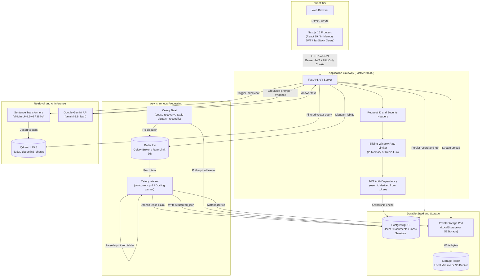
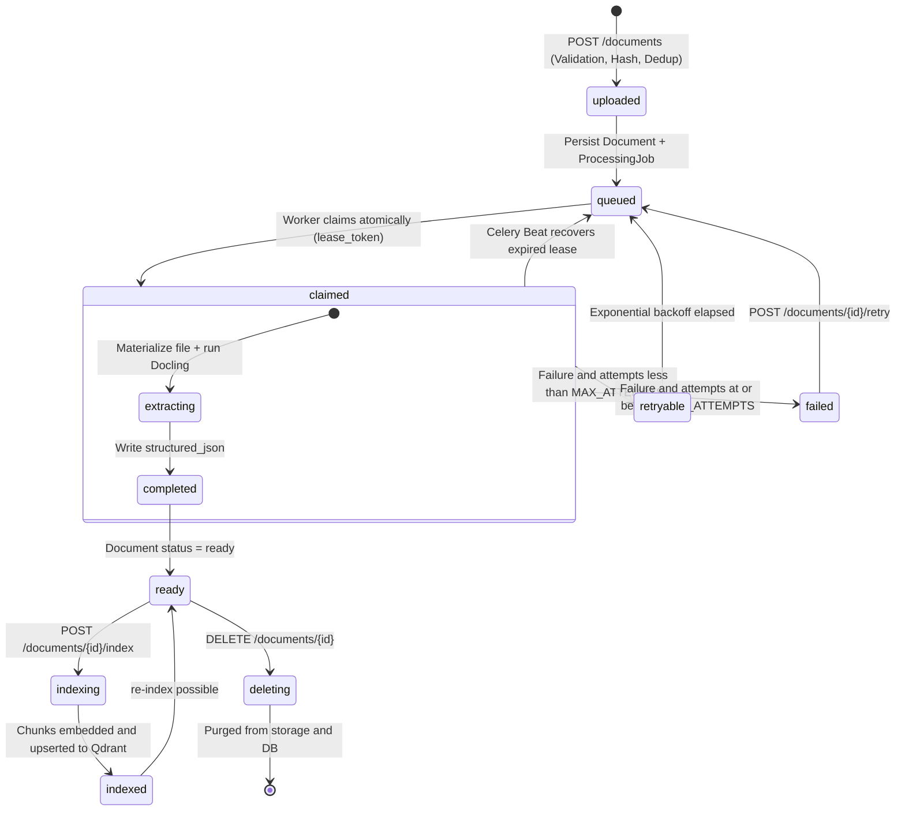
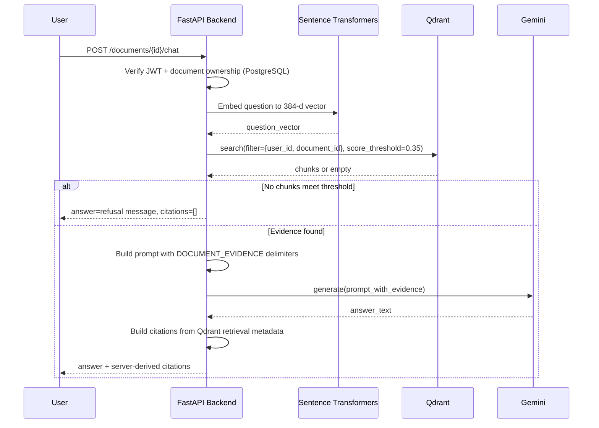

<div align="center">


<br/>

# DocuMind

**Private Documents. Structural Understanding. Verifiable Answers.**

*An open-source workspace that turns complex documents into structured, searchable knowledge — with layout-aware parsing, semantic retrieval, and grounded answers backed by server-verified citations.*

<br/>

[](backend/pyproject.toml)
[](backend/pyproject.toml)
[](frontend/package.json)
[](frontend/tsconfig.json)
[](docker-compose.yml)
[](docker-compose.yml)
[](backend/pyproject.toml)
[](LICENSE)

<br/>

[Overview](#overview) &middot; [Architecture](#system-architecture) &middot; [Pipeline](#document-lifecycle--pipeline) &middot; [RAG & Citations](#grounded-rag--citation-architecture) &middot; [Security](#security--privacy-model) &middot; [Quick Start](#quick-start) &middot; [API](#api-reference) &middot; [Testing](#developer-workflow--testing) &middot; [Roadmap](#roadmap)

</div>

---

## Overview

**DocuMind** is a privately-hosted, full-stack document intelligence system. Upload dense technical documents and get back:

- **Structural parsing** that preserves tables, section hierarchy, and document layout instead of discarding them.
- **Semantic retrieval** across the parsed artifact using a locally-run embedding model.
- **Grounded conversational answers** from Google Gemini, with citations constructed by the server from verified retrieval results, not generated by the model.
- **Private, tenant-isolated storage** where raw file bytes never appear in API responses.

### Why DocuMind is different from a naive RAG demo

| Problem with naive RAG | DocuMind approach |
|---|---|
| Text-dumping parsers destroy tables, hierarchy, and multi-column layouts | IBM Docling preserves structural layout, section headers, and tabular data |
| LLMs fabricate citation references | Citations assembled by server from Qdrant retrieval points; model cannot invent source IDs |
| Document text fed directly into model without boundaries | Content wrapped in `<DOCUMENT_EVIDENCE>` delimiters with explicit untrusted-input framing |
| Background jobs lost on worker restart | PostgreSQL-durable jobs with fenced `lease_token`, bounded retries, and Celery Beat reconciliation |
| Vector queries omit tenant filters, risking cross-user data exposure | Every Qdrant query includes mandatory `user_id` and `document_id` server-side payload filters |

---

## Key Capabilities

### Document Intelligence

| Capability | Detail | Status |
|---|---|---|
| **Private Ingestion** | PDF, DOCX, XLSX, PPTX, TXT, CSV, MD up to 25 MB | Implemented |
| **Upload Hardening** | Magic-byte validation, SHA-256 deduplication, path-traversal guards | Implemented |
| **Layout-Aware Parsing** | IBM Docling preserves section structure, multi-column layout, tables | Implemented |
| **Table Extraction** | Structured table representations stored in `structured_json["tables"]` | Implemented |
| **Multi-Format Export** | Markdown, plain text, JSON artifact, HTML, original file | Implemented |
| **Original File Streaming** | Authenticated raw file via `GET /documents/{id}/raw` | Implemented |

### Retrieval & Grounded AI

| Capability | Detail | Status |
|---|---|---|
| **Section-Aware Chunking** | Deterministic Markdown section splits with stable SHA-256 point IDs | Implemented |
| **Local Embeddings** | `all-MiniLM-L6-v2` (384-d) via Sentence Transformers | Implemented |
| **Filtered Vector Search** | Qdrant with mandatory `user_id` + `document_id` + score threshold | Implemented |
| **Grounded Chat** | Gemini `gemini-3.8-flash` with `<DOCUMENT_EVIDENCE>` framing | Implemented |
| **Server-Derived Citations** | Chunk ID, section, score attached by backend, never by model | Implemented |
| **No-Evidence Refusal** | Deterministic refusal when no chunk meets `RETRIEVAL_MIN_SCORE = 0.35` | Implemented |
| **RAG Evaluation Harness** | `tests/evals/evaluator.py` offline + live Gemini evaluation | Implemented |

### Reliability

| Capability | Detail | Status |
|---|---|---|
| **Durable Job Persistence** | `processing_jobs` table in PostgreSQL is the source of truth | Implemented |
| **Fenced Worker Claims** | Atomic `lease_token` (UUIDv4) prevents duplicate execution | Implemented |
| **Bounded Retry Schedule** | Exponential backoff, max 3 attempts (`PROCESSING_MAX_ATTEMPTS`) | Implemented |
| **Lease Recovery** | Celery Beat reconciles expired leases and stale dispatches | Implemented |
| **Health & Readiness Probes** | `/api/v1/health` (liveness) + `/api/v1/ready` (DB connectivity) | Implemented |
| **Prometheus Metrics** | `/api/v1/metrics` protected by `X-Metrics-Token` header | Implemented |

### Security & Privacy

| Capability | Detail | Status |
|---|---|---|
| **In-Memory Access Tokens** | Short-lived JWT in React state, never in `localStorage` | Implemented |
| **HttpOnly Refresh Cookie** | Rotating sessions; backend stores SHA-256 hash only | Implemented |
| **Token Family Reuse Detection** | Revoked-token replay invalidates entire session family | Implemented |
| **Strict Tenant Isolation** | 404 (not 403) on foreign documents, prevents existence oracle attacks | Implemented |
| **Private Storage Boundary** | Storage keys, S3 URIs never returned to clients | Implemented |
| **Prompt-Injection Defense** | `<DOCUMENT_EVIDENCE>` delimiters + explicit system instructions | Implemented |
| **Fail-Closed Rate Limiting** | Redis Lua sliding window; HTTP 503 if Redis unreachable | Implemented |
| **S3 Adapter** | Implemented with Boto3 + AES-256 SSE; live qualification pending | Partial |

### Developer Experience

| Capability | Detail | Status |
|---|---|---|
| **Docker Compose** | One-command local stack, 7 services, volumes, health checks | Implemented |
| **CI Pipeline** | GitHub Actions: lint, typecheck, test, build, migration SQL on every push | Implemented |
| **Backend Tests** | Pytest: auth, security, storage, export, grounding, chunking | Implemented |
| **Frontend Tests** | Vitest + Testing Library: all UI components | Implemented |
| **Smoke Test Script** | `scripts/smoke_test.py` authenticated deployment verification | Implemented |
| **Architecture Decision Records** | ADR-001 through ADR-008 | Documented |

---

## System Architecture

DocuMind is a **modular monolith** with clear service-layer boundaries. Routes delegate to domain services; third-party SDKs (Docling, Qdrant, Sentence Transformers, Gemini) are quarantined inside their own service modules and never imported directly into route handlers.



### Component Breakdown

| Component | Path | Responsibility |
|---|---|---|
| **Frontend** | `frontend/` | Next.js 16 App Router; JWT in React state; typed API client; dark workspace UI |
| **API Backend** | `backend/app/api/` | FastAPI routes; rate limiting; CORS; security headers; ownership enforcement |
| **Database** | `backend/app/models/` | PostgreSQL 16 via Alembic; users, sessions, documents, processing jobs |
| **Job Queue** | `backend/app/jobs/` | Redis 7.4 + Celery; late-ack, single-prefetch, concurrency=1 workers; Beat reconciler |
| **Private Storage** | `backend/app/storage/` | `PrivateStorage` protocol with `LocalStorage` and `S3Storage` adapters |
| **Vector Search** | `backend/app/indexing/` | Qdrant collection `documind_chunks`; mandatory tenant payload filters on all operations |
| **Grounded Gen** | `backend/app/rag/` | Gemini client; `<DOCUMENT_EVIDENCE>` framing; server-built citation objects |
| **Document Parsing** | `backend/app/processing/` | Docling adapter; lease claim; runner; recovery scheduler |

---

## Document Lifecycle & Pipeline

Every document passes through a verifiable, recoverable state machine backed by relational database state and fenced execution leases.

### State Machine



### Pipeline Stages

**Stage 1 — Upload & Validation**

The user submits a multipart file to `POST /api/v1/documents`. The backend:
- Validates extension against `ALLOWED_UPLOAD_EXTENSIONS` (`.pdf`, `.docx`, `.xlsx`, `.pptx`, `.txt`, `.csv`, `.md`).
- Reads the first 1 MB chunk and verifies magic bytes (`%PDF-` for PDFs, `PK` for Office files).
- Streams and hashes the full body (SHA-256) while enforcing `MAX_UPLOAD_BYTES` (25 MB).
- Returns the existing document record if the SHA-256 hash already exists for this user (deduplication without re-processing).
- Supports an optional `Idempotency-Key` header for safe client retries.

**Stage 2 — Private Storage & Job Persistence**

- File bytes are written to a private, opaque storage key: `uploads/{user_id}/{uuid}.{ext}`. This key is never returned to the client.
- A `documents` row (`status="queued"`) and a `processing_jobs` row (`status="queued"`, `attempt_count=0`) are committed in PostgreSQL.

**Stage 3 — Dispatch & Fenced Worker Claiming**

- The job ID is published to the Redis Celery queue (`document-processing`).
- A Celery worker claims the job with a conditional SQL update: sets `status="claimed"`, generates a unique `lease_token` (UUIDv4), sets `lease_expires_at = now + PROCESSING_LEASE_MINUTES` (default 30 min), increments `attempt_count`.
- If the worker dies mid-execution, Celery Beat detects the expired `lease_expires_at` and safely requeues the job (up to `PROCESSING_MAX_ATTEMPTS = 3`).

**Stage 4 — Layout Parsing & Structured Artifact**

- The worker materializes the private storage object to a temporary local path via an async context manager that unlinks it on exit.
- IBM Docling converts the document into clean Markdown, extracts document metrics, and parses tabular structures.
- On success: `processing_jobs.status = "completed"`, `documents.status = "ready"`, `documents.structured_json` populated.
- On failure: exponential-backoff retry until `PROCESSING_MAX_ATTEMPTS`; terminal state is `"failed"`.

**Stage 5 — Section-Aware Chunking & Indexing** *(explicit trigger)*

Triggered by `POST /api/v1/documents/{id}/index`. Document must be `status="ready"`.
- Markdown split deterministically along section boundaries (`#`, `##`, `###`).
- Deterministic point IDs: `UUID(sha256("{doc_id}:{artifact_version}:{chunk_id}")[:16])` — enables idempotent re-indexing.
- Sentence Transformers produces 384-dimensional normalized vectors locally.
- Vectors upserted to Qdrant with tenant payload fields: `user_id`, `document_id`, `artifact_version`, `section`, `text`.

**Stage 6 — Grounded Retrieval & Chat**

`POST /api/v1/documents/{id}/chat` with `{"question": "..."}`:
- Question embedded and queried against Qdrant with mandatory compound filter: `user_id == current_user_id AND document_id == target_document_id AND score >= RETRIEVAL_MIN_SCORE (0.35)`.
- **If no chunks meet the threshold:** the backend returns the refusal message directly. The LLM is not invoked.
- **If evidence exists:** prompt constructed with `<DOCUMENT_EVIDENCE>` tags framing content as untrusted. Gemini generates the answer. Backend attaches server-verified citations (chunk ID, section, score, page). The model never produces citation IDs.

**Stage 7 — Multi-Format Export**

`GET /api/v1/documents/{id}/export?format={markdown|txt|json|html|original|raw}` returns the parsed artifact or original file bytes with correct MIME types and `Content-Disposition` headers.

---

## Grounded RAG & Citation Architecture



**Key design guarantees:**

- Citations are assembled by the server from Qdrant retrieval points. The model is explicitly prohibited from producing source IDs.
- Document content enters the model only inside `<DOCUMENT_EVIDENCE>` delimiters with explicit untrusted-input framing.
- The no-evidence path returns without invoking the LLM — preventing hallucinated answers on insufficient context.
- Citation precision is tied to retrieval chunk granularity; sentence-level attribution is not claimed.

---

## Security & Privacy Model

```mermaid
flowchart LR
    subgraph Browser["Browser Sandbox"]
        AccessToken["Access JWT\n(React memory only)"]
        Cookie["Refresh Token\n(HttpOnly / Secure / SameSite=Lax)"]
    end

    subgraph Perimeter["Request Perimeter"]
        Limiter["Sliding-Window Limiter\n(fail-closed on Redis outage)"]
        Headers["Security Headers\n(nosniff / X-Frame: DENY / no-referrer)"]
        Validator["Upload Validator\n(magic bytes / SHA-256 / size / path)"]
    end

    subgraph Identity["Tenant Isolation Layer"]
        JWTCheck["JWT Verification\n(user_id derived from token)"]
        Ownership["PostgreSQL Ownership Check\n(404 on foreign documents)"]
        VectorFilter["Mandatory Qdrant Filters\n(user_id / document_id)"]
    end

    subgraph AIBoundary["Grounded AI Boundary"]
        DocEvidence["Untrusted Input Framing\n(DOCUMENT_EVIDENCE delimiters)"]
        ServerCitations["Server-Derived Citations\n(model cannot supply source IDs)"]
    end

    Browser --> Perimeter --> Identity --> AIBoundary
```



### Dual-Token Authentication

- **Access JWT:** Short-lived (60 min). Stored exclusively in React context state — not `localStorage` or `sessionStorage`. Inaccessible to XSS scripts that can only read DOM-accessible storage.
- **Refresh token:** Opaque random token in an `HttpOnly`, `Secure`, `SameSite=Lax` cookie. The backend stores only the SHA-256 hash of the token value.
- **Token family reuse detection:** If an expired or already-revoked refresh token is presented (indicating potential replay), the entire session family is immediately revoked, forcing re-authentication.

### Tenant Isolation

- User identity is derived strictly from the cryptographically verified JWT payload. Clients cannot supply a `user_id` via query parameters or headers.
- Foreign document requests return `404 Not Found`, not `403 Forbidden`, to prevent existence oracle attacks.
- Every Qdrant search, upsert, and delete operation includes server-enforced `user_id` and `document_id` payload filters. Ownership is also verified in PostgreSQL before any vector operation.

### Private Storage

- Storage keys, S3 URIs, and presigned links are never returned to clients.
- Files are materialized to temporary local paths inside async context managers that unlink them after execution.
- Upload streams enforce size caps, magic-byte checks, and path-traversal guards.

### Prompt-Injection Defense

- Document content is injected into Gemini prompts inside `<DOCUMENT_EVIDENCE>` delimiters with explicit system instructions to treat content as untrusted and ignore embedded commands.
- When no evidence meets the relevance threshold, the backend returns a deterministic refusal message without invoking the LLM.

> No system is comprehensively protected against all prompt-injection techniques. These defenses materially reduce the attack surface for common techniques but have not been independently security-audited.

### Rate Limiting

- Route-specific sliding windows: 10 req/min for auth endpoints, 20/min for uploads, 30/min for chat.
- Redis Lua scripts provide atomic tracking across API replicas.
- **Fail-closed:** if the Redis rate-limit backend becomes unreachable, the middleware returns HTTP 503 with a `Retry-After` header. Protected endpoints are never left silently unthrottled.

---

## Engineering Decisions

Formally recorded in [docs/ARCHITECTURE-DECISIONS.md](docs/ARCHITECTURE-DECISIONS.md).

| ADR | Decision | Reason | Consequence |
|---|---|---|---|
| **ADR-001** | Modular monolith, not microservices | Avoids operational complexity at V1 scale; SDK isolation stays clean | Processing can split to a separate process without changing routes |
| **ADR-002** | PostgreSQL canonical; Qdrant derived | Relational integrity, artifact versioning, and deletion correctness owned by one store | Qdrant can be rebuilt from PostgreSQL artifacts if lost |
| **ADR-003** | Abstract storage port | Prevents local-path assumptions from entering processing code; enables S3 swap without logic changes | S3 adapter requires live deployment qualification |
| **ADR-004** | Single Qdrant collection with mandatory filters | Avoids collection sprawl; enables cross-document retrieval in V2 | Filtering must be carefully tested on every query path |
| **ADR-005** | PostgreSQL-durable job contract | Background tasks survive restarts; fenced leases prevent duplicates | Reconciliation logic required; Redis/Celery needed for distribution |
| **ADR-006** | In-memory access JWT + HttpOnly cookie | Eliminates `localStorage` XSS exposure; permits server-controlled session revocation | Requires careful CORS and cookie domain configuration in production |
| **ADR-007** | Server-derived citations | Eliminates LLM citation hallucination; citations are auditable retrieval metadata | Citation granularity tied to chunk boundaries |
| **ADR-008** | $0 demo is not production-grade | Transparent about free-tier constraints without compromising security architecture | Paid-tier upgrade path defined without API rewrites |

---

## Technology Stack

### Core Runtimes & Frameworks

| Area | Technology | Version |
|---|---|---|
| **Backend runtime** | Python | 3.11 / 3.12 |
| **API framework** | FastAPI | 0.141.1 |
| **ASGI server** | Uvicorn | 0.41.0 |
| **Frontend framework** | Next.js | 16.2.0 |
| **UI library** | React | 19.2.0 |
| **Frontend language** | TypeScript | 5.9.2 (`strict: true`) |
| **Server state** | TanStack Query | 5.87.4 |

### Data, Queue & Storage

| Area | Technology | Version |
|---|---|---|
| **Primary database** | PostgreSQL | 16-alpine |
| **Async DB driver** | asyncpg | 0.31.0 |
| **Sync DB driver** | psycopg | 3.2.10 |
| **ORM** | SQLAlchemy | 2.0.54 |
| **Migrations** | Alembic | 1.20.0 |
| **Task queue** | Celery | 5.6.3 |
| **Message broker** | Redis | 7.4-alpine |
| **Object storage** | Local FS / AWS S3 via Boto3 | 1.43.85 |

### AI, ML & Intelligence

| Area | Technology | Version |
|---|---|---|
| **Document parsing** | IBM Docling | 2.129.0 |
| **Vector database** | Qdrant | 1.15.5 (qdrant-client 1.17.0) |
| **Embedding model** | Sentence Transformers (`all-MiniLM-L6-v2`) | 6.1.0 |
| **LLM inference** | Google Gemini (`gemini-3.8-flash`) | google-genai 2.23.0 |

### Code Quality & Testing

| Area | Technology | Version |
|---|---|---|
| **Backend linter** | Ruff | 0.15.1 |
| **Backend tests** | Pytest / pytest-asyncio | 9.0.2 / 1.3.0 |
| **Frontend tests** | Vitest | 3.2.4 |
| **Component testing** | Testing Library | 16.3.0 |
| **HTTP client (tests)** | HTTPX | 0.28.1 |

---

## Repository Structure

```
documind/
├── .github/
│   └── workflows/
│       └── ci.yml                   # CI: lint, typecheck, test, build, migration SQL
├── backend/
│   ├── alembic/
│   │   ├── versions/                # 6 versioned migrations (0001-0006)
│   │   └── env.py                   # Async Alembic environment
│   ├── app/
│   │   ├── api/
│   │   │   ├── routes/              # auth, users, documents, chat, health, operations
│   │   │   ├── deps.py              # JWT verification and user_id injection
│   │   │   └── router.py            # Centralized /api/v1 router
│   │   ├── core/
│   │   │   ├── config.py            # Pydantic Settings with strict validation
│   │   │   ├── errors.py            # Uniform safe error envelope handlers
│   │   │   ├── metrics.py           # Prometheus metrics registry
│   │   │   └── security.py          # bcrypt hashing and JWT helpers
│   │   ├── db/                      # Async engine and session factory
│   │   ├── indexing/                # Chunking algorithms and Qdrant integration
│   │   ├── jobs/                    # Celery app, Beat scheduler, dispatch service
│   │   ├── middleware/              # Request ID, security headers, rate limiter
│   │   ├── models/                  # User, Document, ProcessingJob, RefreshSession
│   │   ├── processing/              # Docling adapter, lease recovery, runner
│   │   ├── rag/                     # Prompt construction, injection defense, Gemini client
│   │   ├── schemas/                 # Pydantic request/response schemas
│   │   ├── storage/                 # PrivateStorage interface, Local and S3 adapters
│   │   └── main.py                  # Application factory and lifespan
│   ├── tests/                       # Pytest suite (auth, security, storage, export, grounding)
│   ├── Dockerfile                   # Multi-stage backend + worker container
│   └── pyproject.toml               # Dependencies and optional extras
├── frontend/
│   ├── app/                         # Next.js App Router (layout.tsx, page.tsx, globals.css)
│   ├── components/
│   │   ├── AppProviders.tsx          # QueryClient + ThemeProvider wrapper
│   │   ├── ChatPanel.tsx             # Multi-turn conversation + citation cards
│   │   ├── DocumentList.tsx          # Library with retry, delete, and preview
│   │   ├── DocumentPreview.tsx       # Tabbed viewer: Markdown, Tables, Original file
│   │   ├── MarkdownRenderer.tsx      # Sanitized Markdown rendering (DOMPurify)
│   │   ├── StatusBadge.tsx           # Processing status chips and progress bar
│   │   ├── ThemeToggle.tsx           # Light/dark theme switcher
│   │   └── UploadZone.tsx            # File upload with 25 MB pre-flight check
│   ├── lib/                          # Typed API client (api.ts), AuthContext, theme context
│   ├── tests/                        # Vitest setup and component tests
│   ├── Dockerfile                    # Frontend container
│   └── package.json                  # Dependencies and npm scripts
├── docs/
│   ├── assets/
│   │   └── hero.svg                  # Pipeline architecture illustration
│   ├── ARCHITECTURE-DECISIONS.md     # ADR-001 through ADR-008
│   ├── ARCHITECTURE.md               # In-depth system design and data-flow specs
│   ├── DESIGN.md                     # UI design system, color tokens
│   ├── IMPLEMENTATION-PROGRESS.md    # Phase-by-phase implementation tracker
│   ├── MASTER-IMPLEMENTATION-PLAN.md # Engineering contract and specifications
│   ├── RELEASE-CHECKLIST.md          # Production release and smoke-test runbook
│   └── ROADMAP.md                    # Post-V1 roadmap and sequencing
├── scripts/
│   └── smoke_test.py                 # Deployment verification script
├── tests/evals/
│   ├── evaluator.py                  # RAG evaluation runner (offline + live)
│   └── rag_cases.jsonl               # Grounding and injection defense test cases
├── storage/                          # Local file storage volume (gitignored)
├── .env.example                      # Master environment variable template
├── docker-compose.yml                # Local multi-service orchestration
└── LICENSE                           # MIT License
```

---

## Quick Start

### Prerequisites

- **Docker Desktop** (or Docker Engine with Compose v2)
- **Git**
- A modern web browser
- *(Optional for local development)* Python 3.11-3.12, Node.js 22+

### 1. Clone and configure

**Windows PowerShell**
```powershell
git clone https://github.com/yashrajagawane/documind.git
cd documind
Copy-Item .env.example .env
```

**Linux / macOS**
```bash
git clone https://github.com/yashrajagawane/documind.git
cd documind
cp .env.example .env
```

Open `.env` and set at minimum:

```ini
# Required - choose a secure value
POSTGRES_PASSWORD=your-local-db-password

# Required - generate with: openssl rand -hex 32
JWT_SECRET_KEY=your-long-random-secret-key

# Optional - needed only for grounded chat Q&A
GEMINI_API_KEY=your-gemini-api-key
```

### 2. Launch the stack

```bash
docker compose up --build
```

This starts seven containers:

| Container | Role | Host Port |
|---|---|---|
| `postgres` | Relational database | `5432` |
| `redis` | Celery broker + rate-limit DB | internal |
| `qdrant` | Vector database | `6333` |
| `backend` | FastAPI API server | `8000` |
| `worker` | Celery document-processing worker | — |
| `scheduler` | Celery Beat reconciler | — |
| `frontend` | Next.js web interface | `3000` |

> The `backend` container runs `alembic upgrade head` automatically before starting Uvicorn.

### 3. Verify and use

| Service | URL |
|---|---|
| **Web interface** | http://localhost:3000 |
| **API base** | http://localhost:8000/api/v1 |
| **Liveness probe** | http://localhost:8000/api/v1/health |
| **Readiness probe** | http://localhost:8000/api/v1/ready |

**First-use workflow:**

1. Open http://localhost:3000 and register an account.
2. Upload a PDF or DOCX document.
3. Wait for the status to reach **Ready** (UI polls automatically).
4. Click **Preview** to inspect the parsed Markdown and extracted tables.
5. Click **Index** to embed and index the document in Qdrant.
6. Open the **Chat** panel and ask a question about the document.
7. Inspect the server-derived citation card returned alongside the answer.

---

## Environment Variables

All variables are validated at startup by Pydantic Settings ([backend/app/core/config.py](backend/app/core/config.py)).

| Variable | Default | Required | Notes |
|---|---|---|---|
| `ENVIRONMENT` | `development` | Yes | Set `production` to enforce secret validation |
| `CORS_ORIGINS` | `http://localhost:3000` | Yes | Comma-separated allowed browser origins |
| `DATABASE_URL` | *(see .env.example)* | Yes | `postgresql+asyncpg://...` connection string |
| `POSTGRES_DB` | `documind` | Yes | Database name |
| `POSTGRES_USER` | `documind` | Yes | Database user |
| `POSTGRES_PASSWORD` | — | **Yes** | Must be set in `.env` |
| `JWT_SECRET_KEY` | `replace-with-a-long-random-secret` | **Yes** | Must be changed outside `development` mode |
| `JWT_ALGORITHM` | `HS256` | No | JWT signing algorithm |
| `JWT_ACCESS_EXPIRE_MINUTES` | `60` | No | Access token lifespan in minutes |
| `JWT_REFRESH_EXPIRE_DAYS` | `14` | No | Refresh session lifespan in days |
| `REFRESH_COOKIE_SECURE` | `false` | No | Set `true` in production (requires HTTPS) |
| `JOB_QUEUE_BACKEND` | `celery` | No | `celery` (distributed) or `inprocess` (lightweight local) |
| `CELERY_BROKER_URL` | `redis://redis:6379/0` | If Celery | Redis broker URL |
| `RATE_LIMIT_BACKEND` | `redis` | No | `redis` (multi-replica) or `memory` |
| `RATE_LIMIT_REDIS_URL` | `redis://redis:6379/1` | If Redis | Dedicated Redis DB for rate limiting |
| `STORAGE_BACKEND` | `local` | No | `local` (STORAGE_DIR) or `s3` |
| `STORAGE_DIR` | `storage` | If local | Local storage path |
| `S3_BUCKET` | — | If S3 | S3 bucket name |
| `S3_REGION` | `us-east-1` | If S3 | AWS region |
| `S3_ENDPOINT_URL` | — | If S3 | Custom endpoint (e.g., MinIO) |
| `S3_ACCESS_KEY_ID` | — | If S3 | AWS access key |
| `S3_SECRET_ACCESS_KEY` | — | If S3 | AWS secret key |
| `S3_SERVER_SIDE_ENCRYPTION` | `AES256` | If S3 | SSE algorithm |
| `S3_KMS_KEY_ID` | — | If S3 + KMS | KMS key ID for SSE-KMS |
| `MAX_UPLOAD_BYTES` | `26214400` (25 MB) | No | Maximum file upload size in bytes |
| `ALLOWED_UPLOAD_EXTENSIONS` | `.pdf,.docx,...` | No | Comma-separated permitted extensions |
| `QDRANT_URL` | `http://qdrant:6333` | Yes | Qdrant base URL |
| `QDRANT_API_KEY` | — | If auth | Qdrant API key (for managed Qdrant Cloud) |
| `QDRANT_COLLECTION` | `documind_chunks` | No | Shared vector collection name |
| `EMBEDDING_MODEL` | `sentence-transformers/all-MiniLM-L6-v2` | No | Hugging Face embedding model |
| `EMBEDDING_DIMENSIONS` | `384` | No | Embedding vector dimensions |
| `GEMINI_API_KEY` | — | Optional | Required for grounded chat |
| `GEMINI_MODEL` | `gemini-3.8-flash` | No | Gemini model name |
| `RETRIEVAL_TOP_K` | `5` | No | Maximum retrieved chunks per query |
| `RETRIEVAL_MIN_SCORE` | `0.35` | No | Minimum relevance threshold for evidence |
| `PROCESSING_LEASE_MINUTES` | `30` | No | Worker lease duration before recovery |
| `PROCESSING_MAX_ATTEMPTS` | `3` | No | Maximum processing retry attempts |
| `PROCESSING_DISPATCH_STALE_SECONDS` | `300` | No | Stale dispatch recovery threshold |
| `METRICS_TOKEN` | — | Optional | `X-Metrics-Token` header value for `/metrics` |
| `TRUSTED_PROXY_CIDRS` | — | Optional | Comma-separated trusted proxy CIDRs |

---

## API Reference

All business endpoints are versioned under `/api/v1`.

### Error Envelope

All non-2xx responses use a consistent, safe error envelope. Internal details, stack traces, and filesystem paths are never exposed:

```json
{
  "success": false,
  "error": {
    "code": "NOT_FOUND",
    "message": "Document not found.",
    "request_id": "c0a80101-8b2f-4c1d-9e3a-7a5f6e8b9c0d"
  }
}
```

### Authentication

| Method | Endpoint | Auth | Description |
|---|---|---|---|
| `POST` | `/api/v1/auth/register` | None | Register with email and password (min 12 chars) |
| `POST` | `/api/v1/auth/login` | None | Authenticate; returns access JWT + sets HttpOnly refresh cookie |
| `POST` | `/api/v1/auth/refresh` | Cookie | Rotate refresh session; returns new access JWT |
| `POST` | `/api/v1/auth/logout` | Cookie | Revoke session family; delete cookie |

### User

| Method | Endpoint | Auth | Description |
|---|---|---|---|
| `GET` | `/api/v1/users/me` | Bearer | Authenticated user metadata (`id`, `email`) |

### Document Management

| Method | Endpoint | Auth | Description |
|---|---|---|---|
| `POST` | `/api/v1/documents` | Bearer | Upload document via `multipart/form-data`. Optional `Idempotency-Key` header. |
| `GET` | `/api/v1/documents` | Bearer | List owned documents, ordered by creation date |
| `GET` | `/api/v1/documents/{id}` | Bearer | Retrieve document status and processing progress |
| `GET` | `/api/v1/documents/{id}/preview` | Bearer | Parsed Markdown, statistics, and extracted tables |
| `POST` | `/api/v1/documents/{id}/index` | Bearer | Embed chunks and upsert to Qdrant. Returns `{"indexed_chunks": N}` |
| `GET` | `/api/v1/documents/{id}/raw` | Bearer | Stream original file bytes inline with detected MIME type |
| `GET` | `/api/v1/documents/{id}/export` | Bearer | Download parsed artifact: `?format=markdown`, `txt`, `json`, `html`, `original` |
| `POST` | `/api/v1/documents/{id}/retry` | Bearer | Requeue a document in `failed` state |
| `DELETE` | `/api/v1/documents/{id}` | Bearer | Delete document, storage object, and vector points. Returns `204` |

### Grounded Chat

| Method | Endpoint | Auth | Description |
|---|---|---|---|
| `POST` | `/api/v1/documents/{id}/chat` | Bearer | Ask a question about an indexed document |

**Request:**
```json
{ "question": "What is the termination clause in Section 4?" }
```

**Response (evidence found):**
```json
{
  "answer": "According to Section 4.2, either party may terminate this agreement upon 30 days written notice.",
  "citations": [
    {
      "chunk_id": "chunk_004",
      "section": "4. Termination",
      "score": 0.87,
      "page": null
    }
  ]
}
```

**Response (no evidence):**
```json
{
  "answer": "I could not find enough information in the uploaded document to answer that.",
  "citations": []
}
```

### Observability

| Method | Endpoint | Auth | Description |
|---|---|---|---|
| `GET` | `/api/v1/health` | None | Liveness probe. Returns `{"status": "healthy"}` |
| `GET` | `/api/v1/ready` | None | Readiness probe — verifies DB connectivity. Returns `503` if unready |
| `GET` | `/api/v1/metrics` | Header `X-Metrics-Token` | Prometheus-compatible operational metrics |

---

## Developer Workflow & Testing

### Backend Development

```powershell
cd backend

# Install core + dev dependencies
python -m pip install ".[dev]"

# Install optional processing, indexing, and RAG dependencies (for full local execution)
python -m pip install ".[processing,indexing,rag]"

# Lint
ruff check .

# Tests
pytest

# Validate migrations compile to valid SQL (no live database required)
alembic upgrade head --sql
```

Test modules in `backend/tests/`:

| File | Coverage |
|---|---|
| `test_auth.py` | Registration, login, refresh rotation, logout, reuse detection |
| `test_security.py` | Ownership boundaries, foreign-document isolation, rate limit enforcement |
| `test_storage.py` | Upload mechanics, magic-byte validation, SHA-256 deduplication |
| `test_export.py` | Multi-format export, MIME types, original file projection |
| `test_grounding.py` | Prompt-injection defense, no-evidence refusal, citation structure |
| `test_chunking.py` | Section-aware chunking, deterministic point ID generation |
| `test_health.py` | Liveness and readiness probes |
| `test_metrics.py` | Metrics token enforcement |
| `test_processing.py` | Job state transitions and lease mechanics |
| `test_recovery.py` | Celery Beat lease recovery |

### Frontend Development

```powershell
cd frontend

npm ci
npm run lint       # ESLint
npm run typecheck  # tsc --noEmit
npm test           # vitest run
npm run build      # Next.js production build
```

### CI Pipeline

GitHub Actions ([.github/workflows/ci.yml](.github/workflows/ci.yml)) runs on every push and pull request:

- **Frontend:** `npm ci` → `eslint` → `tsc --noEmit` → `vitest run` → `next build`
- **Backend:** `pip install ".[dev]"` → `ruff check` → `pytest` → `alembic upgrade head --sql`

### Smoke Testing

Verifies a running deployment end-to-end:

```powershell
# Liveness and readiness checks only
python scripts/smoke_test.py --base-url http://localhost:8000

# Full authenticated test (register, login, /me, upload, logout)
python scripts/smoke_test.py --base-url http://localhost:8000 `
  --email smoke@example.test `
  --password "use-a-12-character-test-password"
```

### RAG Evaluation

```powershell
# Offline: prompt structure, injection defense, boundary tests (no API key needed)
python tests/evals/evaluator.py

# Live: end-to-end generative evaluation through Gemini (requires GEMINI_API_KEY)
python tests/evals/evaluator.py --live
```

The evaluation dataset is in [`tests/evals/rag_cases.jsonl`](tests/evals/rag_cases.jsonl). It covers prompt-injection defense, no-evidence refusal, and grounding correctness.

---

## Project Status & Honest Limitations

Implementation tracked in [docs/IMPLEMENTATION-PROGRESS.md](docs/IMPLEMENTATION-PROGRESS.md).

### Implemented and tested

- [x] JWT registration, login, refresh rotation, and logout lifecycle
- [x] Token family reuse detection (replay protection)
- [x] Multipart upload validation (magic bytes, SHA-256 deduplication, size limits, traversal guards)
- [x] Abstract storage interface with `LocalStorage` and `S3Storage` adapters
- [x] Asynchronous job persistence, Celery worker execution, bounded retries, and Beat lease recovery
- [x] Docling document parsing into Markdown, statistics, and `structured_json["tables"]`
- [x] Section-aware chunking, stable point ID generation, and Qdrant vector upsert and search
- [x] Grounded chat pipeline with `<DOCUMENT_EVIDENCE>` framing and server-derived citations
- [x] Deterministic no-evidence refusal (LLM not invoked when threshold not met)
- [x] Multi-format export (Markdown, TXT, JSON, HTML) and original file streaming
- [x] Sliding-window rate limiting with in-memory and Redis Lua backends (fail-closed on Redis outage)
- [x] Protected Prometheus operational metrics endpoint
- [x] Next.js 16 frontend with upload zone, document library, tabbed preview (Markdown, Tables, Original), chat panel
- [x] Light/dark theme system with accessible toggle
- [x] Real-time UI polling for in-progress processing jobs
- [x] Multi-turn session conversation history with citation cards
- [x] Automated RAG evaluation harness (`tests/evals/evaluator.py`)
- [x] Full Docker Compose stack with health checks and volume persistence
- [x] GitHub Actions CI on every push (lint, typecheck, test, build, migration SQL)
- [x] Release smoke-test script

### Known limitations and pending qualification

**S3 Adapter:** Implemented with Boto3, supports streaming uploads and AES-256 SSE. Live qualification against specific bucket policies, lifecycle rules, and restore rehearsals must be performed in the target deployment environment before declaring it production-ready.

**Docling memory requirements:** IBM Docling loads deep layout and computer vision models. Worker concurrency is set to 1 by default. Hosting tiers with less than 4 GB RAM available to the worker container will encounter OOM errors on heavy documents.

**Prometheus aggregation:** The `/metrics` endpoint exposes data from the running process, but scrapers, alert managers, and Grafana dashboards are deployment-specific operational tasks not included in this repository.

**Docker required for full local stack:** The complete multi-service stack requires Docker Desktop or Docker Engine. Individual services can be run bare-metal, but this requires manual configuration of all service connections.

**Demo vs. production:** Free hosting tiers have ephemeral storage, sleeping services, and quota constraints. The architecture is designed to upgrade to paid tiers without API rewrites. See [ADR-008](docs/ARCHITECTURE-DECISIONS.md).

**Security audit status:** The described defenses (prompt injection, rate limiting, tenant isolation) represent intentional engineering choices. The system has not been independently security-audited.

---

## Troubleshooting

**Port conflicts** — `docker compose up` fails with `bind: address already in use` for ports 5432, 6333, 8000, or 3000.

Stop conflicting local services or remap host ports in `docker-compose.yml` (e.g., change `"5432:5432"` to `"5433:5432"` for PostgreSQL).

**Missing JWT_SECRET_KEY** — Backend fails with `ValueError: JWT_SECRET_KEY must be changed outside development`.

Set `ENVIRONMENT=development` in `.env` for local testing, or generate a long random secret: `openssl rand -hex 32`.

**Database not ready** — `/api/v1/ready` returns HTTP 503.

PostgreSQL may still be initializing its cluster. Check with `docker compose ps` and `docker compose logs postgres`. The backend container has a `depends_on: condition: service_healthy` guard, but startup can still be slow on first boot.

**Docling fails or times out** — Document enters `failed` state with `PARSER_FAILED` or `PARSER_UNAVAILABLE`.

Ensure the worker container has at least 4 GB of RAM allocated in Docker Desktop settings. Verify optional processing dependencies are installed: `pip install ".[processing]"`. In Docker Compose, the backend `Dockerfile` installs all extras in the image.

**Chat returns 503** — `POST /chat` returns `{"detail": "Vector indexing is not configured"}`.

Verify Qdrant is running (`docker compose ps`). Ensure the document has been indexed via `POST /api/v1/documents/{id}/index` before asking questions. Check that `QDRANT_URL` is reachable from the backend container.

**Frontend shows stale processing state** — Document stuck in `queued` or `extracting` for a long time.

Check worker container logs: `docker compose logs worker`. If the worker has exited, restart with `docker compose restart worker`. If the lease has expired (30 min default), Celery Beat will automatically requeue it.

---

## Roadmap

Full sequencing in [docs/ROADMAP.md](docs/ROADMAP.md).

| Milestone | Theme | Selected items |
|---|---|---|
| **V1.1 Quality of Life** | Ergonomics | Multi-file batch upload, persistent chat threads per document, shareable summary links, keyboard shortcuts |
| **V1.2 Reliability & Scale** | Hardening | Validated S3 lifecycle policies, distributed Redis rate limiting, centralized Prometheus/Grafana dashboards |
| **V2.0 Cross-Document** | Intelligence | Cross-library semantic retrieval, document comparison, auto-tagging and classification on ingest |
| **V2.5 Collaboration** | Multi-user | Team workspaces, role-based access (Owner/Editor/Viewer), citation-anchored annotations |
| **V3.0 Platform** | Integrations | Public API with API keys, inbound connectors (Slack, Notion, Google Drive), outbound webhooks |

**Not planned (see [docs/ROADMAP.md](docs/ROADMAP.md) for rationale):** native mobile app, SSO/enterprise auth, self-serve billing, fine-tuned or self-hosted models.

---

## Contributing

Contributions are welcome. Before opening a pull request, read the engineering conventions:

- [Backend Engineering Conventions](docs/SKILLS-BACKEND.md)
- [Frontend Engineering Conventions](docs/SKILLS-FRONTEND.md)
- [System Architecture](docs/ARCHITECTURE.md)
- [Architectural Decision Records](docs/ARCHITECTURE-DECISIONS.md)

**Pre-commit checklist:**

```powershell
# Backend
cd backend
ruff check .
pytest
alembic upgrade head --sql

# Frontend
cd ../frontend
npm run lint
npm run typecheck
npm test
```

All CI checks must pass. New features that touch the security model, storage boundary, or vector filtering logic should include corresponding tests.

---

## License

This project is licensed under the **MIT License** — see [LICENSE](LICENSE) for details.

Copyright &copy; 2026 yashrajagawane.
