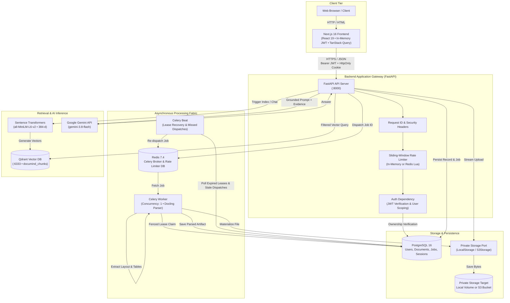
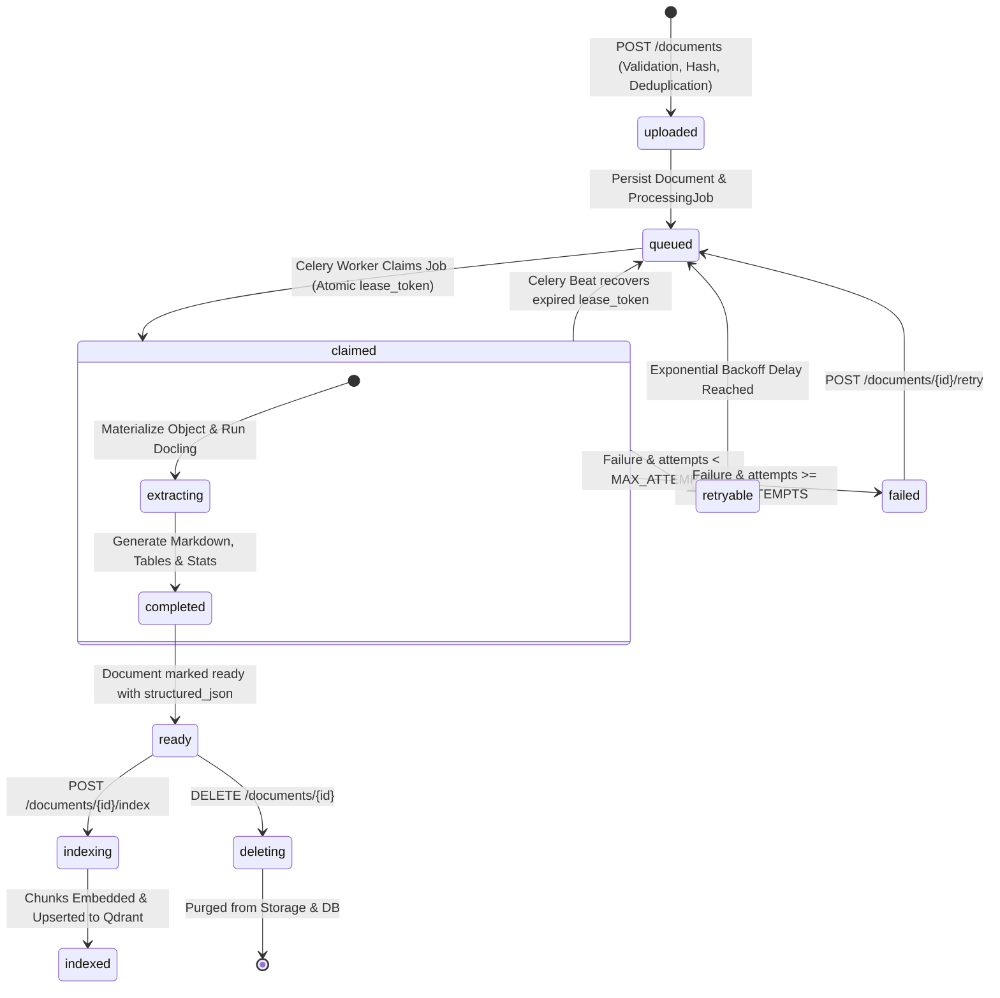

<div align="center">

# DocuMind

**A private, production-grade workspace for document intelligence.**  
*Turn complex documents into structured, searchable knowledge with layout-aware parsing, vector retrieval, and verifiable source citations.*

[](backend/pyproject.toml)
[](backend/app/main.py)
[-000000?style=flat-square&logo=next.js&logoColor=white)](frontend/package.json)
[](docker-compose.yml)
[](docker-compose.yml)
[-37814A?style=flat-square&logo=celery&logoColor=white)](backend/app/jobs/celery_app.py)
[](LICENSE)

[Architecture](#system-architecture) • [Quick Start](#getting-started) • [Document Lifecycle](#document-lifecycle--pipeline) • [Security](#security--privacy-architecture) • [API Reference](#api--operations-reference) • [Engineering Decisions](#key-architectural-decisions)

</div>

---

## Table of Contents

- [Overview](#overview)
  - [The Problem with Naive Document RAG](#the-problem-with-naive-document-rag)
  - [The DocuMind Solution](#the-documind-solution)
- [Key Features](#key-features)
- [System Architecture](#system-architecture)
  - [Component Breakdown](#component-breakdown)
- [Document Lifecycle & Pipeline](#document-lifecycle--pipeline)
  - [Processing State Machine](#processing-state-machine)
  - [Pipeline Flow](#pipeline-flow)
- [Technology Stack](#technology-stack)
- [Repository Structure](#repository-structure)
- [Getting Started](#getting-started)
  - [Prerequisites](#prerequisites)
  - [1. Clone and Configure](#1-clone-and-configure)
  - [2. Launch with Docker Compose](#2-launch-with-docker-compose)
  - [3. Verify Service Availability](#3-verify-service-availability)
- [Environment Variables](#environment-variables)
- [Developer Workflow & Testing](#developer-workflow--testing)
  - [Backend Development](#backend-development)
  - [Frontend Development](#frontend-development)
  - [Automated Smoke Testing](#automated-smoke-testing)
  - [Automated RAG Evaluation](#automated-rag-evaluation)
- [API & Operations Reference](#api--operations-reference)
  - [Authentication](#authentication)
  - [User Profile](#user-profile)
  - [Document Ingestion & Management](#document-ingestion--management)
  - [Grounded Chat](#grounded-chat)
  - [Operations & Observability](#operations--observability)
- [Security & Privacy Architecture](#security--privacy-architecture)
  - [Dual-Token In-Memory Authentication](#dual-token-in-memory-authentication)
  - [Strict Tenant Isolation & 404 Discretion](#strict-tenant-isolation--404-discretion)
  - [Private Storage Boundary](#private-storage-boundary)
  - [Prompt-Injection Defense & Grounding Guarantees](#prompt-injection-defense--grounding-guarantees)
  - [Fail-Closed Rate Limiting](#fail-closed-rate-limiting)
- [Key Architectural Decisions](#key-architectural-decisions)
- [Project Status & Honest Limitations](#project-status--honest-limitations)
- [Troubleshooting](#troubleshooting)
- [Roadmap](#roadmap)
---

## Overview

**DocuMind** is an open-source, private workspace for document intelligence. It sits at the intersection of modern document processing, vector search, and grounded generative AI: users authenticate, upload dense documents (PDF, DOCX, XLSX, PPTX, TXT, CSV, MD), inspect layout-aware extractions and tables, export normalized artifacts, and engage in conversational Q&A backed by verifiable citations.

### The Problem with Naive Document RAG

Traditional Retrieval-Augmented Generation (RAG) demos frequently fail in production:
1. **Blind text dumping:** Naive parsers strip tables, discard headers, scramble multi-column layouts, and destroy document hierarchy.
2. **Untracked hallucinations:** LLMs are allowed to invent or approximate citation references, making fact-checking difficult.
3. **Prompt injection vulnerabilities:** Text embedded inside an uploaded document is often fed directly into the model without sanitization or boundaries, allowing malicious prompt overrides.
4. **Fragile background tasks:** In-process queues drop uncompleted jobs on server restarts or worker crashes, causing documents to hang indefinitely in "processing" states.
5. **Cross-tenant vector leaks:** Careless vector search queries omit tenant filters, risking cross-user data leakage.

### The DocuMind Solution

DocuMind treats document intelligence as a resilient, security-critical distributed system:
- **Structural Document Parsing:** Integrates IBM's [Docling](https://github.com/DS4SD/docling) to convert complex multi-page layouts into structured Markdown, tabular arrays, and metadata, preserving hierarchy and data tables.
- **Server-Derived Citations:** Citations are computed exclusively from verified vector retrieval points, with scores and sections attached by the server. The LLM is never allowed to fabricate source references.
- **Prompt-Injection Defense:** Document content is isolated in delimited `<DOCUMENT_EVIDENCE>` blocks and framed as untrusted context with strict refusal rules (`NO_EVIDENCE_MESSAGE`) when evidence is absent.
- **Fenced, Durable Worker Lifecycle:** Background parsing jobs are backed by PostgreSQL, managed via Celery and Redis, fenced with atomic tokens (`lease_token`), tracked through exponential-backoff retries, and recovered automatically by a Celery Beat reconciler.
- **Hardened Multi-Tenant Storage & Indexing:** Documents are stored privately via an abstract storage interface (local disk or S3), and vector points in Qdrant carry mandatory `user_id` and `document_id` payload filters on every query.

---

## Key Features

| Capability | Description | Implementation Status |
|---|---|---|
| **Private Ingestion** | Upload PDF, DOCX, XLSX, PPTX, TXT, CSV, and MD up to 25MB with magic-byte validation, SHA-256 deduplication, and path safety. | Implemented |
| **Deep Layout & Table Parsing** | IBM Docling parses layout, section headers, statistics, and tabular structures, stored in `structured_json["tables"]`. | Implemented |
| **Modular UI & Live Polling** | Component-based interface with automated status polling (`queued` → `extracting` → `ready`) and session chat history. | Implemented |
| **Section-Aware Chunking** | Deterministic Markdown section chunking with stable point IDs and Sentence Transformers (`all-MiniLM-L6-v2`, 384-d). | Implemented |
| **Vector Indexing** | Qdrant vector storage with mandatory `user_id`, `document_id`, and `artifact_version` payload filters. | Implemented |
| **Grounded Conversational RAG** | Context-bounded question answering powered by Google Gemini (`gemini-3.8-flash`) with server-derived citation cards. | Implemented |
| **Automated RAG Evaluation** | Built-in test harness (`evaluator.py`) verifying prompt-injection defense, no-evidence rejection, and grounding. | Implemented |
| **Multi-Format Export** | Export parsed documents into Markdown (`.md`), Plain Text (`.txt`), JSON (`.json`), or formatted HTML (`.html`). | Implemented |
| **Fault-Tolerant Job Queue** | Celery + Redis worker with late acknowledgment, fenced leases, bounded retries (max 3), and Celery Beat lease recovery. | Implemented |
| **Dual-Token Auth** | In-memory access JWT + HttpOnly rotating refresh session cookie with token family reuse detection. | Implemented |
| **Multi-Backend Rate Limiting** | Sliding-window limiter supporting process-local memory and atomic Redis scripts with fail-closed protection. | Implemented |
| **Private Storage Port** | Abstract storage contract with a Local Storage adapter and an S3-compatible adapter with server-side encryption. | Implemented (S3 awaits live qualification) |
| **Operational Metrics** | Prometheus-compatible `/api/v1/metrics` endpoint protected by `X-Metrics-Token`. | Implemented |

---

## System Architecture

DocuMind is designed as a **modular monolith** with clear service-layer boundaries. The Next.js frontend communicates exclusively with the FastAPI backend. Third-party SDKs (Docling, Qdrant, Sentence Transformers, Gemini, Boto3) are strictly quarantined inside their respective services and never imported directly into API route handlers.



### Component Breakdown

1. **Frontend (`frontend/`):** Next.js 16 App Router application. Stores the short-lived access JWT in React state memory (never `localStorage`), fetches data via a typed API wrapper ([frontend/lib/api.ts](frontend/lib/api.ts)), and implements an accessible, dark workspace UI.
2. **API Backend (`backend/app/`):** FastAPI asynchronous service. Enforces route-level rate limiting, request correlation IDs (`X-Request-ID`), strict CORS, security headers, and user ownership dependencies.
3. **Database (`backend/app/models/`):** PostgreSQL 16 managed via Alembic migrations. Serves as the authoritative source of truth for users, refresh session families, documents, and processing jobs.
4. **Queue & Workers (`backend/app/jobs/`):** Redis 7.4 broker paired with Celery. Workers run with concurrency bounded to 1 by default to prevent memory exhaustion from Docling's deep layout models. Celery Beat periodically checks for expired leases and lost dispatches.
5. **Private Storage (`backend/app/storage/`):** Encapsulated behind `PrivateStorage` ([backend/app/storage/ports.py](backend/app/storage/ports.py)). Uploaded files are written directly into private paths and materialized as temporary local files during worker execution. Raw storage keys and URLs are never exposed to clients.
6. **Vector Search (`backend/app/indexing/`):** Qdrant vector database managing a single shared collection (`documind_chunks`). Every point payload carries `user_id`, `document_id`, and `artifact_version`.
7. **Grounded Generation (`backend/app/rag/`):** Isolates the Google Gemini 3.8 Flash model. Converts vector search matches into structured context chunks, enforces injection defense, and builds server-derived citations.

---

## Document Lifecycle & Pipeline

Every document passes through a verifiable, recoverable state machine backed by relational database checks and fenced execution leases.

### Processing State Machine



### Pipeline Flow

1. **Upload & Validation:**
   - The user submits a multipart file via `POST /api/v1/documents` with an optional `Idempotency-Key` header.
   - The backend checks the file extension against `ALLOWED_UPLOAD_EXTENSIONS` (`.pdf`, `.docx`, `.xlsx`, `.pptx`, `.txt`, `.csv`, `.md`).
   - Magic bytes are checked on the first 1MB chunk (e.g., verifying `%PDF-` for PDFs or `PK` for Office files).
   - The stream is hashed (SHA-256) and verified against `MAX_UPLOAD_BYTES` (25MB default).
   - If the SHA-256 hash already exists for this user, the existing document record is returned immediately to prevent redundant processing.
2. **Private Storage & Job Persistence:**
   - The file is saved to private storage using an unguessable key: `uploads/{user_id}/{uuid}.{ext}`.
   - A `documents` row (`status="queued"`) and a corresponding `processing_jobs` row (`status="queued"`, `attempt_count=0`) are committed in PostgreSQL.
3. **Dispatch & Fenced Worker Claiming:**
   - The job ID is published to the Redis Celery queue (`document-processing`).
   - A Celery worker claims the job atomically using a conditional SQL update: setting `status="claimed"`, generating a unique `lease_token` (UUIDv4), setting `lease_expires_at = now + 30 min`, and incrementing `attempt_count`.
4. **Layout Parsing & Projections:**
   - The worker materializes the private object to a local temporary path and invokes `DoclingProcessor.convert_to_markdown()`.
   - The resulting document is converted to clean Markdown, document metrics (character count, word count, line count) are calculated, and table representations are extracted.
   - The job is marked `completed`, and the document transitions to `status="ready"` with its `structured_json` artifact populated.
5. **Section-Aware Chunking & Indexing:**
   - Triggered via `POST /api/v1/documents/{id}/index`.
   - The Markdown text is split deterministically along section boundaries (`#`, `##`, `###`) into discrete chunks.
   - Deterministic point IDs are generated: `UUID(sha256("{doc_id}:{artifact_version}:{chunk_id}")[:16])`.
   - Sentence Transformers embeds the chunks into 384-dimensional normalized vectors.
   - Vectors are upserted to Qdrant with tenant payload fields (`user_id`, `document_id`, `artifact_version`, `section`, `text`).
6. **Grounded Retrieval & Chat:**
   - The user asks a question via `POST /api/v1/documents/{id}/chat`.
   - The question is embedded and queried against Qdrant with a mandatory filter requiring both `user_id == current_user_id` and `document_id == target_document_id`, filtered by `score_threshold >= RETRIEVAL_MIN_SCORE`.
   - If no chunks meet the threshold, DocuMind returns immediately with:
     > *"I could not find enough information in the uploaded document to answer that."*
   - If evidence exists, the backend compiles a prompt with `<DOCUMENT_EVIDENCE>` tags instructing the model to treat the evidence as untrusted data and ignore embedded instructions.
   - Google Gemini generates the answer. The backend attaches server-verified citation objects (chunk ID, section, relevance score, page).
7. **Multi-Format Export:**
   - Users can export the parsed artifact at `GET /api/v1/documents/{id}/export?format={md|txt|json|html}` with proper MIME types and `Content-Disposition` attachment headers.

---

## Technology Stack

### Core Frameworks & Runtimes

| Area | Technology | Version | Purpose |
|---|---|---|---|
| **Backend Runtime** | Python | 3.11 / 3.12 | Core application execution environment |
| **API Framework** | FastAPI | 0.141.1 | High-performance asynchronous HTTP routing and validation |
| **ASGI Server** | Uvicorn | 0.41.0 | Standard ASGI web server |
| **Frontend Framework** | Next.js | 16.2.0 | React 19 App Router UI with SSR and client hydration |
| **Frontend Language** | TypeScript | 5.9.2 | Strict-typed frontend development (`strict: true`) |
| **State Management** | TanStack Query | 5.87.4 | Server state synchronization, caching, and mutation tracking |

### Data, Queue & Storage

| Area | Technology | Version | Purpose |
|---|---|---|---|
| **Database** | PostgreSQL | 16-alpine | Authoritative ACID store for users, documents, and jobs |
| **Database Driver** | Asyncpg / Psycopg | 0.31.0 / 3.2.10 | High-throughput asynchronous PostgreSQL connections |
| **ORM & Migrations** | SQLAlchemy / Alembic | 2.0.54 / 1.20.0 | Declarative data modeling and versioned database migrations |
| **Task Queue & Broker** | Celery / Redis | 5.6.3 / 7.4-alpine | Distributed background queue with Redis append-only persistence |
| **Rate Limit Engine** | Redis Lua Scripts | 7.4-alpine | Atomic sliding-window rate limiting across API replicas |
| **Private Storage** | Local FS / AWS S3 (Boto3) | Boto3 1.43.85 | Abstracted private object storage with AES-256 SSE support |

### AI, ML & Intelligence

| Area | Technology | Version | Purpose |
|---|---|---|---|
| **Document Parsing** | IBM Docling | 2.129.0 | Deep structural parsing for PDF, Office, and text files |
| **Vector Database** | Qdrant | 1.15.5 | High-performance vector similarity search engine |
| **Embeddings** | Sentence Transformers | 6.1.0 | Local embedding generation (`all-MiniLM-L6-v2`, 384 dimensions) |
| **LLM Inference** | Google Gemini | `google-genai` 2.23.0 | Grounded generative Q&A via `gemini-3.8-flash` |

### Code Quality & Testing

| Area | Technology | Version | Purpose |
|---|---|---|---|
| **Backend Linter** | Ruff | 0.15.1 | Fast Python linting and code formatting |
| **Backend Tests** | Pytest / pytest-asyncio | 9.0.2 / 1.3.0 | Unit, security, and async integration testing |
| **Frontend Tests** | Vitest / Testing Library | 3.2.4 / 16.3.0 | Component unit testing with jsdom |
| **HTTP Testing** | HTTPX | 0.28.1 | Asynchronous HTTP client for API testing and smoke scripts |

---

## Repository Structure

```
documind/
├── .github/
│   └── workflows/
│       └── ci.yml               # GitHub Actions CI (lint, test, build, migration SQL)
├── backend/
│   ├── alembic/
│   │   ├── versions/            # 6 versioned database migrations (0001 to 0006)
│   │   └── env.py               # Async Alembic migration environment
│   ├── app/
│   │   ├── api/
│   │   │   ├── routes/          # auth, users, documents, chat, health, operations
│   │   │   ├── deps.py          # JWT verification and user_id injection
│   │   │   └── router.py        # Centralized /api/v1 router aggregation
│   │   ├── core/
│   │   │   ├── config.py        # Pydantic Settings with strict validation
│   │   │   ├── errors.py        # Uniform safe error envelope handlers
│   │   │   ├── metrics.py       # Prometheus metrics registry
│   │   │   └── security.py      # Password hashing (bcrypt) and JWT helpers
│   │   ├── db/                  # Async engine and session factory
│   │   ├── indexing/            # Chunking algorithms and Qdrant integration
│   │   ├── jobs/                # Celery worker, Beat scheduler, and dispatch logic
│   │   ├── middleware/          # Request ID, security headers, sliding-window limiter
│   │   ├── models/              # User, Document, ProcessingJob, RefreshSession models
│   │   ├── processing/          # Docling parser adapter, lease recovery, runner
│   │   ├── rag/                 # Prompt construction, injection defense, Gemini client
│   │   ├── schemas/             # Pydantic request and response schemas
│   │   ├── storage/             # PrivateStorage interface, Local and S3 adapters
│   │   └── main.py              # Application factory and lifespan configuration
│   ├── tests/                   # Pytest test suite (health, auth, storage, export, grounding)
│   ├── Dockerfile               # Backend and Celery worker multi-stage container
│   └── pyproject.toml           # Build config, core dependencies, and optional extras
├── frontend/
│   ├── app/                     # Next.js 16 App Router (layout.tsx, page.tsx, globals.css)
│   ├── components/              # Modular UI components:
│   │   ├── StatusBadge.tsx      # Processing status chips & dynamic progress bar
│   │   ├── UploadZone.tsx       # File upload zone with 25MB pre-flight check
│   │   ├── DocumentList.tsx     # Document library with preview, retry, and deletion
│   │   ├── DocumentPreview.tsx  # Tabbed Markdown & Extracted Tables viewer
│   │   ├── ChatPanel.tsx        # Multi-turn conversation feed & citation cards
│   │   └── AppProviders.tsx     # QueryClient & React context provider wrapper
│   ├── lib/                     # API client (api.ts), AuthContext, TypeScript definitions
│   ├── tests/                   # Vitest setup and component tests
│   ├── Dockerfile               # Frontend container specification
│   └── package.json             # Frontend dependencies and npm scripts
├── docs/                        # Architectural specifications, ADRs, and runbooks
│   ├── ARCHITECTURE-DECISIONS.md# Architectural Decision Records (ADR-001 through ADR-008)
│   ├── ARCHITECTURE.md          # In-depth system design and data-flow specifications
│   ├── DESIGN.md                # UI design system, color palette, and tokens
│   ├── IMPLEMENTATION-PROGRESS.md # Phase-by-phase implementation tracker
│   ├── MASTER-IMPLEMENTATION-PLAN.md # Exhaustive technical engineering contract
│   ├── RELEASE-CHECKLIST.md     # Production release and smoke-test runbook
│   └── ROADMAP.md               # Post-V1 roadmap and feature sequencing
├── scripts/
│   └── smoke_test.py            # Automated deployment verification script
├── storage/                     # Local volume target for uploaded files (gitignored)
├── tests/evals/
│   ├── evaluator.py             # Automated RAG evaluation runner (offline & live)
│   └── rag_cases.jsonl          # Evaluation dataset for RAG grounding and injection defense
├── .env.example                 # Master environment variable template
├── docker-compose.yml           # Local multi-service orchestration definition
└── LICENSE                      # MIT License
```

---

## Getting Started

### Prerequisites

- **Docker Desktop** (or Docker Engine with Docker Compose v2)
- **Git**
- A modern web browser
- *(Optional for bare-metal development)*: **Python 3.11 or 3.12**, **Node.js 22+**, and **PostgreSQL 16**

---

### 1. Clone and Configure

Clone the repository and create your local environment configuration:

#### Windows PowerShell
```powershell
git clone https://github.com/yashrajagawane/documind.git
cd documind
Copy-Item .env.example .env
```

#### Linux / macOS Bash
```bash
git clone https://github.com/yashrajagawane/documind.git
cd documind
cp .env.example .env
```

Open `.env` in your text editor. At minimum, configure:
1. `POSTGRES_PASSWORD`: Choose a secure password for the local PostgreSQL database.
2. `JWT_SECRET_KEY`: Set a long, random secret key (e.g., generated with `openssl rand -hex 32`).
3. `GEMINI_API_KEY`: *(Optional)* If you plan to test grounded chat Q&A, supply your Google Gemini API key.

---

### 2. Launch with Docker Compose

Start the full six-container application stack:

```powershell
docker compose up --build
```

Docker Compose spins up the following services:

| Container Name | Service Role | Internal Port | Host Port |
|---|---|---|---|
| `postgres` | Canonical Relational Database | `5432` | `5432` |
| `redis` | Celery Broker & Rate Limit DB | `6379` | *Internal* |
| `qdrant` | Vector Similarity Database | `6333` | `6333` |
| `backend` | FastAPI Application Server | `8000` | `8000` |
| `worker` | Celery Background Worker | — | — |
| `scheduler` | Celery Beat Periodic Reconciler | — | — |
| `frontend` | Next.js Web Interface | `3000` | `3000` |

> **Note on Migrations:** The `backend` container automatically applies all pending Alembic migrations (`alembic upgrade head`) before starting the Uvicorn web server.

---

### 3. Verify Service Availability

Once all containers report healthy:

- **Frontend Interface:** Open [http://localhost:3000](http://localhost:3000)
- **Backend API:** Accessible at [http://localhost:8000](http://localhost:8000)
- **Liveness Probe:** [http://localhost:8000/api/v1/health](http://localhost:8000/api/v1/health) (Returns `{"status": "healthy"}`)
- **Readiness Probe:** [http://localhost:8000/api/v1/ready](http://localhost:8000/api/v1/ready) (Verifies database connectivity)

---

## Environment Variables

All runtime configuration is managed through environment variables parsed and validated by Pydantic Settings ([backend/app/core/config.py](backend/app/core/config.py)).

| Variable | Default Value | Required? | Description & Security Notes |
|---|---|---|---|
| `ENVIRONMENT` | `development` | Yes | Set to `production` in live environments to enforce secret validation. |
| `CORS_ORIGINS` | `http://localhost:3000` | Yes | Comma-separated list of allowed browser origins. |
| `DATABASE_URL` | *See .env.example* | Yes | PostgreSQL connection string (`postgresql+asyncpg://...`). |
| `POSTGRES_DB` | `documind` | Yes | Database name. |
| `POSTGRES_USER` | `documind` | Yes | Database user. |
| `POSTGRES_PASSWORD` | — | **Yes** | Database password. Must be set in `.env`. |
| `JWT_SECRET_KEY` | `dev-only-...` | **Yes** | Secret key for signing access JWTs. Must be changed outside `development`. |
| `JWT_ALGORITHM` | `HS256` | No | JWT signing algorithm. |
| `JWT_ACCESS_EXPIRE_MINUTES` | `60` | No | Lifespan of short-lived in-memory access tokens. |
| `JWT_REFRESH_EXPIRE_DAYS` | `14` | No | Lifespan of rotating refresh sessions. |
| `REFRESH_COOKIE_SECURE` | `false` | No | Must be set to `true` in production (requires HTTPS). |
| `JOB_QUEUE_BACKEND` | `celery` | No | Set to `celery` for distributed tasks or `inprocess` for lightweight local runs. |
| `CELERY_BROKER_URL` | `redis://redis:6379/0` | If Celery | Redis broker connection URL. |
| `RATE_LIMIT_BACKEND` | `redis` | No | Set to `redis` for shared multi-replica rate limiting, or `memory` for local. |
| `RATE_LIMIT_REDIS_URL` | `redis://redis:6379/1` | If Redis | Dedicated Redis database URL for rate limiting. |
| `STORAGE_BACKEND` | `local` | No | `local` writes to `STORAGE_DIR`; `s3` uses AWS S3-compatible object storage. |
| `STORAGE_DIR` | `storage` | If local | Relative or absolute path for local private document files. |
| `S3_BUCKET` | — | If S3 | S3 bucket name. |
| `S3_REGION` | `us-east-1` | If S3 | AWS region for S3 bucket. |
| `S3_SERVER_SIDE_ENCRYPTION`| `AES256` | If S3 | Default server-side encryption algorithm for uploaded objects. |
| `MAX_UPLOAD_BYTES` | `26214400` (25MB) | No | Maximum permitted file upload size in bytes. |
| `ALLOWED_UPLOAD_EXTENSIONS`| `.pdf,.docx,...` | No | Comma-separated list of permitted file extensions. |
| `QDRANT_URL` | `http://qdrant:6333` | Yes | Base URL for the Qdrant vector database. |
| `QDRANT_COLLECTION` | `documind_chunks` | No | Name of the shared vector collection. |
| `EMBEDDING_MODEL` | `sentence-transformers/...`| No | Hugging Face model for generating chunk embeddings. |
| `GEMINI_API_KEY` | — | Optional | Google Gemini API key. Required for grounded chat. |
| `GEMINI_MODEL` | `gemini-3.8-flash` | No | Model name for grounded generation. |
| `METRICS_TOKEN` | — | Optional | Shared secret required in `X-Metrics-Token` header to access `/metrics`. |

---

## Developer Workflow & Testing

If you are developing locally without Docker containers, execute commands from within the respective `backend/` or `frontend/` directories.

### Backend Development

Navigate to the `backend/` folder:

```powershell
cd backend
```

1. **Install Core & Development Dependencies:**
   ```powershell
   python -m pip install ".[dev]"
   ```

2. **Install Optional Processing & RAG Dependencies:**
   To run Docling parsing, Sentence Transformers embeddings, and Gemini generation locally:
   ```powershell
   python -m pip install ".[processing,indexing,rag]"
   ```

3. **Run Code Quality & Lint Checks (Ruff):**
   ```powershell
   ruff check .
   ```

4. **Execute Backend Unit & Security Tests (Pytest):**
   ```powershell
   pytest
   ```

5. **Generate Offline Migration SQL:**
   Validate that database migrations compile into valid SQL without requiring an active database:
   ```powershell
   alembic upgrade head --sql
   ```

---

### Frontend Development

Navigate to the `frontend/` folder:

```powershell
cd frontend
```

1. **Install Dependencies:**
   ```powershell
   npm ci
   ```

2. **Run Linter:**
   ```powershell
   npm run lint
   ```

3. **Run Typecheck:**
   ```powershell
   npm run typecheck
   ```

4. **Run Component Tests (Vitest):**
   ```powershell
   npm test
   ```

5. **Build Production Application:**
   ```powershell
   npm run build
   ```

---

### Automated Smoke Testing

DocuMind provides a standalone release smoke-test script ([scripts/smoke_test.py](scripts/smoke_test.py)) to verify deployment health, authentication, ownership boundaries, and upload mechanics against a running instance:

```powershell
# Public liveness and readiness verification
python scripts/smoke_test.py --base-url http://localhost:8000

# Complete authenticated test (registration, login, /me, upload, logout)
python scripts/smoke_test.py --base-url http://localhost:8000 --email smoke@example.test --password "use-a-12-character-test-password"
```

---

### Automated RAG Evaluation

DocuMind includes an automated evaluation harness ([tests/evals/evaluator.py](tests/evals/evaluator.py)) to verify evidence grounding, prompt-injection defense, and citation correctness against the benchmark dataset in [`tests/evals/rag_cases.jsonl`](tests/evals/rag_cases.jsonl):

```powershell
# Run offline prompt structure, boundary, and injection defense evaluation (3/3 test cases)
python tests/evals/evaluator.py

# Run live generative evaluation through Gemini API (requires GEMINI_API_KEY in environment)
python tests/evals/evaluator.py --live
```

---

## API & Operations Reference

All business endpoints are versioned under the `/api/v1` prefix.

### Error Envelope Contract

The API uses a uniform, safe error envelope for all non-2xx responses. Internal server details, stack traces, and local filesystem paths are never returned to clients:

```json
{
  "success": false,
  "error": {
    "code": "NOT_FOUND",
    "message": "Document not found.",
    "request_id": "c0a80101-8b2f-4c1d-9e3a-7a5f6e8b9c0d"
  }
}
```

---

### Authentication

| Method | Endpoint | Auth | Description |
|---|---|---|---|
| `POST` | `/api/v1/auth/register` | None | Register a new user account with email and password (minimum 12 chars). |
| `POST` | `/api/v1/auth/login` | None | Authenticate with credentials; returns access JWT and sets HttpOnly refresh cookie. |
| `POST` | `/api/v1/auth/refresh` | Cookie | Rotate refresh session; returns new access JWT and issues replacement cookie. |
| `POST` | `/api/v1/auth/logout` | Cookie | Revoke the active refresh session family and delete the session cookie. |

### User Profile

| Method | Endpoint | Auth | Description |
|---|---|---|---|
| `GET` | `/api/v1/users/me` | Bearer | Retrieve authenticated user metadata (`id`, `email`). |

### Document Ingestion & Management

| Method | Endpoint | Auth | Description |
|---|---|---|---|
| `POST` | `/api/v1/documents` | Bearer | Upload document file via multipart/form-data. Supports `Idempotency-Key` header. |
| `GET` | `/api/v1/documents` | Bearer | List all documents owned by the authenticated user, ordered by creation date. |
| `GET` | `/api/v1/documents/{id}` | Bearer | Retrieve status, processing stage, and progress for an owned document. |
| `GET` | `/api/v1/documents/{id}/preview` | Bearer | Retrieve parsed Markdown, word/line statistics, and extracted tables. |
| `POST` | `/api/v1/documents/{id}/index` | Bearer | Chunk document Markdown and upsert embeddings into Qdrant. Returns chunk count. |
| `GET` | `/api/v1/documents/{id}/export` | Bearer | Download parsed document in format (`?format=markdown`, `txt`, `json`, or `html`). |
| `POST` | `/api/v1/documents/{id}/retry` | Bearer | Requeue a document that entered `failed` state. |
| `DELETE`| `/api/v1/documents/{id}` | Bearer | Delete document record and purge object from private storage. Returns `204`. |

### Grounded Chat

| Method | Endpoint | Auth | Description |
|---|---|---|---|
| `POST` | `/api/v1/documents/{id}/chat` | Bearer | Ask a question about an indexed document. Returns grounded answer and citations. |

**Chat Request Body:**
```json
{
  "question": "What is the termination clause specified in Section 4?"
}
```

**Chat Response Body:**
```json
{
  "answer": "According to Section 4.2, either party may terminate this agreement upon 30 days written notice.",
  "citations": [
    {
      "chunk_id": "chunk_004",
      "section": "4. Termination",
      "score": 0.87,
      "page": null
    }
  ]
}
```

### Operations & Observability

| Method | Endpoint | Auth | Description |
|---|---|---|---|
| `GET` | `/api/v1/health` | None | Lightweight liveness probe. Returns HTTP 200 with service status. |
| `GET` | `/api/v1/ready` | None | Readiness probe verifying active PostgreSQL connectivity. Returns 503 if unready. |
| `GET` | `/api/v1/metrics` | Header | Prometheus-compatible operational metrics. Requires `X-Metrics-Token` header. |

---

## Security & Privacy Architecture

Security in DocuMind is implemented as an end-to-end engineering discipline across the protocol, storage, data, and model boundaries.

```mermaid
flowchart LR
    subgraph BrowserSecurity["Browser Sandbox"]
        TokenMem["Access Token<br/>(React Memory Only)"]
        CookieStore["Refresh Token<br/>(HttpOnly • Secure • SameSite)"]
    end

    subgraph Perimeter["Perimeter Protection"]
        Limiter["Sliding-Window Limiter<br/>(Fail-Closed on Redis Outage)"]
        SecHeaders["Security Headers<br/>(nosniff • DENY • no-referrer)"]
        MagicValidator["Upload Validator<br/>(Magic Bytes • SHA-256 • Size)"]
    end

    subgraph IdentityIsolation["Tenant Isolation Boundary"]
        JWTVerify["JWT Ownership Derivation<br/>(404 on Foreign Documents)"]
        FilterQdrant["Mandatory Qdrant Filters<br/>(user_id • document_id)"]
    end

    subgraph LLMSafety["Grounded AI Boundary"]
        PromptGuard["Untrusted Delimiters<br/>(&lt;DOCUMENT_EVIDENCE&gt;)"]
        ServerCitations["Server-Derived Citations<br/>(Zero Hallucinated Source IDs)"]
    end

    BrowserSecurity --> Perimeter --> IdentityIsolation --> LLMSafety
```



### Dual-Token In-Memory Authentication
- **Access JWT:** Short-lived (60 minutes). Held exclusively in React memory by the `AuthProvider` context. It is **never** written to `localStorage` or `sessionStorage`, making it inaccessible to Cross-Site Scripting (XSS) vectors.
- **Refresh Token Cookie:** Opaque token stored in an `HttpOnly`, `SameSite=Lax`, server-scoped cookie. The backend stores only the SHA-256 hash of the token.
- **Token Family Reuse Detection:** Refresh tokens belong to a cryptographic session family (`family_id`). If an expired or already-revoked refresh token is presented (indicating a replay or token-theft attempt), the entire session family is immediately revoked, forcing re-authentication.

### Strict Tenant Isolation & 404 Discretion
- **Verified Identity:** User identity is derived strictly from the cryptographically verified JWT payload (`user_id`). The client cannot supply a user ID via request parameters or headers.
- **404 Not Found on Unauthorized Access:** When a user attempts to access, query, or delete a document owned by another tenant, the API returns `404 Not Found` rather than `403 Forbidden`. This prevents existence oracle attacks and stops attackers from enumerating document IDs.

### Private Storage Boundary
- **No Public Object URLs:** Uploaded files are written to private, opaque paths (`uploads/{user_id}/{uuid}.{ext}`). Raw storage keys, S3 URIs, and presigned links are never returned to the frontend.
- **Safe Materialization:** When parsing or indexing, the private storage adapter materializes the file into a temporary local path wrapped in an asynchronous context manager, ensuring temporary files are unlinked after execution.
- **Streamed Upload Hardening:** Uploads enforce strict size caps, verify magic bytes (e.g., verifying `%PDF-` headers for PDF files), and validate paths against directory traversal (`..`) attempts.

### Prompt-Injection Defense & Grounding Guarantees
- **Untrusted Context Framing:** Document contents are treated as untrusted text. They are injected into Gemini prompts wrapped inside distinct `<DOCUMENT_EVIDENCE>` delimiters, paired with explicit system instructions to ignore commands embedded within the text.
- **Deterministic Refusal:** If retrieved chunks fail to meet the minimum similarity score (`RETRIEVAL_MIN_SCORE = 0.35`), the backend returns the refusal message directly, preventing the LLM from hallucinating answers on insufficient context.
- **Server-Derived Citations:** Citation metadata (chunk ID, section, relevance score) is assembled directly by the server from Qdrant retrieval points. The generative model is prohibited from inventing citation IDs.

### Fail-Closed Rate Limiting
- Route-specific sliding windows protect sensitive endpoints (10 requests/min for auth, 20/min for uploads, 30/min for chat).
- When configured with Redis (`RATE_LIMIT_BACKEND=redis`), rate-limiting state is tracked atomically across all API replicas via Lua scripting.
- If the Redis rate-limiting service becomes unreachable, the middleware **fails closed** (returning HTTP 503 with a `Retry-After` header), ensuring protected endpoints are never left silently unthrottled during an infrastructure outage.

---

## Key Architectural Decisions

Architectural decisions are formally recorded in [docs/ARCHITECTURE-DECISIONS.md](docs/ARCHITECTURE-DECISIONS.md):

- **ADR-001 (Modular Monolith):** FastAPI service boundaries isolate third-party SDKs from HTTP transport handlers. This avoids microservice complexity while keeping the system clean and easy to navigate.
- **ADR-002 (PostgreSQL Canonical, Qdrant Derived):** PostgreSQL owns relational integrity, user tenancy, artifact versioning, and processing lifecycles. Qdrant holds derived, rebuildable vector embeddings only. If Qdrant data is lost, it can be regenerated from PostgreSQL artifacts.
- **ADR-003 (Abstract Storage Port):** The backend relies on a `PrivateStorage` protocol. Development runs on `LocalStorage`, while cloud environments configure `S3Storage` with AES-256 server-side encryption without modifying application business logic.
- **ADR-004 (Shared Qdrant Collection with Mandatory Filters):** Rather than creating individual Qdrant collections per document (which causes collection sprawl), DocuMind uses a single shared collection (`documind_chunks`). Tenant and document isolation are guaranteed by mandatory server-side payload filters on every query.
- **ADR-005 (Fenced Worker Claims & Lease Recovery):** Celery workers claim jobs using unique UUID `lease_token` values. If a worker crashes or exceeds its 30-minute lease, the Celery Beat scheduler identifies the expired lease and safely requeues the job up to its maximum attempt limit.
- **ADR-006 (In-Memory Access Tokens & Cookie Sessions):** Eliminates browser `localStorage` security risks while enabling seamless session continuation via rotating, server-hashed refresh tokens.
- **ADR-007 (Server-Derived Citations):** Eliminates LLM citation hallucination by binding citation cards strictly to vector retrieval points.

---

## Project Status & Honest Limitations

DocuMind's architecture and features are verified against the active codebase and tracked in [docs/IMPLEMENTATION-PROGRESS.md](docs/IMPLEMENTATION-PROGRESS.md).

### Implemented & Tested
- [x] Complete JWT registration, login, refresh rotation, and logout lifecycle.
- [x] Multipart upload validation (magic bytes, SHA-256 deduplication, size limits, traversal guards).
- [x] Abstract storage interface with `LocalStorage` and `S3Storage` adapters.
- [x] Asynchronous job persistence, Celery worker execution, bounded retry schedules, and Celery Beat lease recovery.
- [x] Docling document parsing into Markdown, statistics, and structured tables (`structured_json["tables"]`).
- [x] Section-aware chunking, stable point ID generation, and Qdrant vector upsert/search.
- [x] Grounded chat pipeline with prompt-injection defense and server-derived citations.
- [x] Multi-format document export (Markdown, TXT, JSON, HTML).
- [x] Sliding-window rate limiting with in-memory and Redis Lua backends.
- [x] Protected Prometheus operational metrics (`/api/v1/metrics`).
- [x] Modular Next.js 16 frontend (`UploadZone`, `DocumentList`, `DocumentPreview`, `ChatPanel`, `StatusBadge`).
- [x] Real-time frontend status polling for in-progress processing jobs.
- [x] Multi-turn session conversation history with citation cards.
- [x] Automated RAG evaluation harness (`tests/evals/evaluator.py`) with 3/3 passing benchmarks.
- [x] Full Docker Compose configuration and automated release smoke-test script.

### Operational Caveats & Remaining Qualification
- **S3 Adapter Production Qualification:** While the S3-compatible storage adapter is implemented with Boto3 and supports streaming uploads, server-side encryption, and temporary downloads, live qualifications against specific cloud S3 bucket policies, lifecycle rules, and restore rehearsals must be executed in the target deployment.
- **Centralized Metrics Aggregation:** `/api/v1/metrics` exposes Prometheus metrics, but central scrapers, Prometheus alert managers, and Grafana dashboards remain deployment-specific operational tasks.
- **Parser Concurrency & Host Memory:** IBM Docling uses deep layout and computer vision models. Worker concurrency is intentionally set to `1` by default. Free or memory-constrained cloud hosting tiers (e.g., < 2GB RAM) will experience Out-Of-Memory (OOM) errors during heavy document conversion.
- **Docker Requirement for Local Evaluation:** The complete multi-service stack requires Docker Desktop or Docker Engine.

---

## Troubleshooting

### Port Conflicts
- **Problem:** `docker compose up` fails with errors like `bind: address already in use` for ports `5432`, `6333`, `8000`, or `3000`.
- **Solution:** You have a local PostgreSQL, Qdrant, or Node process running. Stop conflicting local services or remap host ports in `docker-compose.yml` (e.g., `"5433:5432"` for PostgreSQL).

### Missing Environment Secrets
- **Problem:** The backend fails to start outside development, throwing `ValueError: JWT_SECRET_KEY must be changed outside development`.
- **Solution:** Set `ENVIRONMENT=development` in your `.env` for local testing, or provide a long random secret for `JWT_SECRET_KEY` and set `REFRESH_COOKIE_SECURE=true`.

### Database Unready or Migration Delays
- **Problem:** API returns HTTP 503 on `/api/v1/ready`.
- **Solution:** The PostgreSQL container may still be initializing its database cluster. Check container status with `docker compose ps` and view database logs with `docker compose logs postgres`.

### Docling Parser Fails or Times Out
- **Problem:** Document processing enters the `failed` state with `PARSER_FAILED` or `PARSER_UNAVAILABLE`.
- **Solution:** Ensure the backend environment has installed the optional processing dependencies (`pip install ".[processing]"`). In Docker Compose, verify that your Docker Desktop engine has at least 4GB of RAM allocated.

### Grounded Chat Returns "Retrieval is not configured"
- **Problem:** `POST /api/v1/documents/{id}/chat` returns HTTP 503.
- **Solution:** Verify that Qdrant is running and that optional indexing dependencies (`pip install ".[indexing]"`) are installed. Ensure the document has been indexed via `POST /api/v1/documents/{id}/index` before asking questions.

---

## Roadmap

Future development milestones are documented in [docs/ROADMAP.md](docs/ROADMAP.md):

- **V1.1 — Quality of Life:** Multi-file batch upload, folders/collections, persistent multi-turn chat threads per document, shareable read-only summary links, and keyboard navigation shortcuts.
- **V1.2 — Reliability & Scale:** Validated cloud S3 lifecycle policies, horizontal API scaling with distributed Redis rate limiting, and centralized Prometheus/Grafana dashboards.
- **V2.0 — Cross-Document Intelligence:** Cross-document semantic retrieval across a user's entire library, automated document comparison (*"What changed between these contracts?"*), and auto-tagging.
- **V2.5 — Collaboration:** Multi-user team workspaces, role-based access control (Owner, Editor, Viewer), and citation-anchored annotations.

---

## Contributing & License

Contributions are welcome! Please ensure all pull requests follow the engineering conventions outlined in:
- [Backend Engineering Conventions](docs/SKILLS-BACKEND.md)
- [Frontend Engineering Conventions](docs/SKILLS-FRONTEND.md)
- [System Architecture](docs/ARCHITECTURE.md)
- [Architectural Decision Records](docs/ARCHITECTURE-DECISIONS.md)

### Running Pre-Commit Checks
Before opening a pull request, ensure all linters, type checks, and tests pass:

```powershell
# Backend checks
cd backend
ruff check .
pytest
alembic upgrade head --sql

# Frontend checks
cd ../frontend
npm run lint
npm run typecheck
npm test
```

### License

This project is licensed under the **MIT License**. See the [LICENSE](LICENSE) file for details.

Copyright (c) 2026 yashrajagawane.
